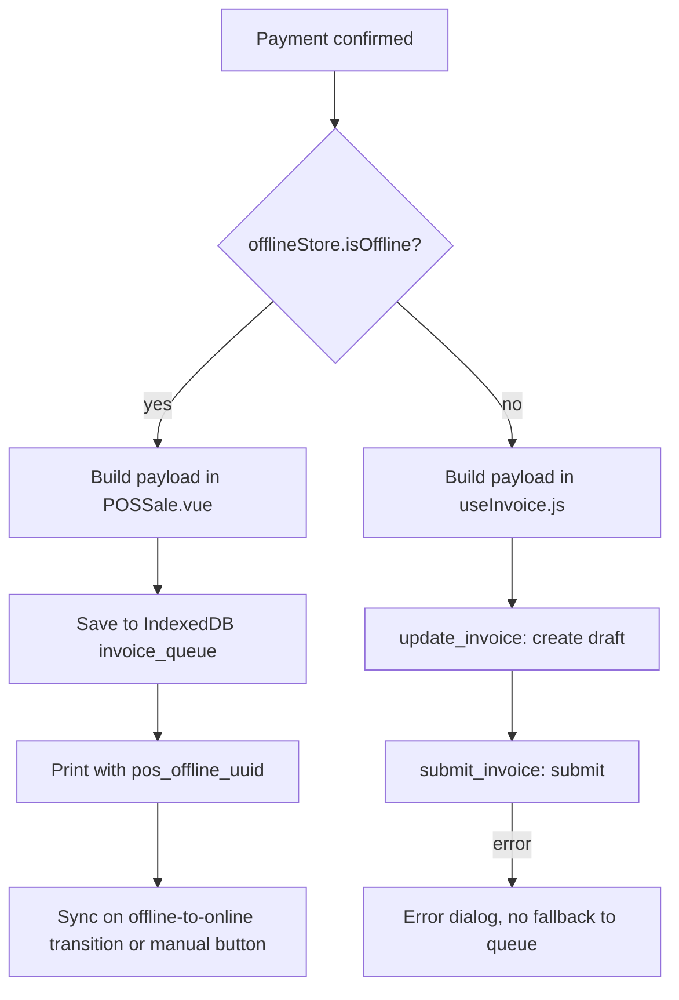

# 01. فهم التطبيق وتقييمه

تاريخ الفحص: 2026-11-06. الفرع: `feature/bluetooth-printer`.

## 1. ما هو التطبيق

POS Next نقطة بيع مبنية فوق ERPNext، وهو تطبيق Frappe يضم خلفية Python وواجهة Vue منفصلة.

| الطبقة | التقنية | الحجم التقريبي |
|---|---|---|
| الواجهة | Vue 3.5، Pinia، frappe-ui، Vite 5، Tailwind | حوالي 59 ألف سطر في `POS/src` |
| التخزين المحلي | IndexedDB عبر Dexie 4، داخل Web Worker | جداول طابور وكاش |
| الخلفية | Frappe وERPNext، مع ملف API رئيسي من 3195 سطرًا | حوالي 14 ألف سطر في `pos_next/api` و`tasks` و`services` و`overrides` |
| اللحظي | Socket.IO لتحديث المخزون والملف الشخصي | |
| الطباعة | Web Bluetooth، WebUSB، QZ Tray، نافذة `/printview` | |
| النشر | PWA يُخدم من `/pos`، وأصوله من `/assets/pos_next/pos/` | |

البيئة الفعلية على هذا الخادم Frappe 16.54 وERPNext 16.53، بينما يذكر `README.md` الإصدار 15. يجب تثبيت الإصدار المستهدف قبل بدء التنفيذ.

### أكبر الملفات التي ستتأثر

| الملف | الأسطر | الملاحظة |
|---|---:|---|
| [POSSale.vue](../../POS/src/pages/POSSale.vue) | 3250 | منطق الدفع والأوفلاين والطباعة في صفحة واحدة |
| [invoices.py](../../pos_next/api/invoices.py) | 3195 | إنشاء الفواتير والمرتجعات والعروض في ملف واحد |
| [itemSearch.js](../../POS/src/stores/itemSearch.js) | 2223 | بحث وكاش ومزامنة خلفية معًا |
| [offline.worker.js](../../POS/src/workers/offline.worker.js) | 1902 | كل عمليات IndexedDB تقريبًا |
| [useInvoice.js](../../POS/src/composables/useInvoice.js) | 1425 | حساب الفاتورة وإرسالها أونلاين |

## 2. كيف يعمل البيع الآن

المسار يتفرع في [POSSale.vue:2236](../../POS/src/pages/POSSale.vue#L2236) حسب حالة الشبكة **لحظة الضغط على الدفع**، وكل فرع يبني بيانات الفاتورة بشكل مختلف.

## 3. بطاقة التقييم

الدرجات تقدير مهني من 10 بناءً على قراءة الكود، وليست مقياسًا آليًا.

| المحور | الدرجة | السبب المختصر |
|---|---:|---|
| الواجهة ووظائف نقطة البيع | 8 | ميزات واسعة: عروض، كوبونات، محفظة، مرتجعات، ورديات، طباعة |
| القراءة أوفلاين | 6 | كاش جيد للأصناف والعملاء، لكن الضرائب غير مخزنة |
| البيع أوفلاين | 5 | يعمل في الجلسة المفتوحة، وبياناته أقل من الأونلاين |
| موثوقية المزامنة | 3 | لا مزامنة دورية، ولا تصنيف أخطاء، ولا حماية من التكرار أونلاين |
| رؤية الفشل ومعالجته | 2 | الفشل يبقى على الجهاز ولا يصل للخادم |
| صحة المحاسبة بعد المزامنة | 3 | التاريخ والخصم وإقفال الوردية تتأثر |
| الأمان | 4 | صلاحيات واسعة في إنشاء الفواتير، ولا تشفير محلي |
| الجاهزية لتعدد المنصات | 3 | ارتباط مباشر بالمتصفح والكوكيز والمسارات النسبية |
| الاختبارات وCI | 2 | اختبار واجهة واحد يفشل، واختبارات CI معطلة |
| دقة الوثائق | 5 | وثائق كثيرة، وبعضها يصف سلوكًا غير موجود |

**الخلاصة:** الأساس الوظيفي قوي ويستحق البناء عليه، لكن طبقة الأوفلاين والمزامنة تحتاج إعادة تصميم قبل الانتقال إلى Electron وAndroid. نقل التصميم الحالي إلى منصات جديدة سيضاعف المشاكل بدل حلها.

## 4. النتائج

كل نتيجة لها معرّف تستخدمه خطة التنفيذ في [05-roadmap.md](05-roadmap.md). **الحرجة** قد تسبب خسارة مالية أو بيانات خاطئة، و**العالية** تعيق التشغيل الموثوق، و**المتوسطة** دين تقني مؤثر.

### حرجة

| المعرّف | المشكلة | الدليل | الأثر |
|---|---|---|---|
| F-01 | سجل الفشل لا يبقى في الخادم. الدالة تكتب `Failed` داخل `finally`، ثم يعيد Frappe المعاملة كلها عند أي استثناء. سجل `Error Log` يُدرج في المعاملة نفسها أيضًا. | [invoices.py:1532](../../pos_next/api/invoices.py#L1532)، وملف `frappe/app.py` السطر 159 | لا يوجد في الخادم أثر للفواتير الفاشلة، والتقرير الصحي لا يعرضها. |
| F-02 | المسار الأونلاين لا يرسل `offline_id`، فهو بلا حماية من التكرار. | [useInvoice.js:1053](../../POS/src/composables/useInvoice.js#L1053) | إذا نجح الترحيل وضاع الرد، فإعادة المحاولة تنشئ فاتورة ثانية وحركة مخزون ثانية. |
| F-03 | فشل الشبكة أثناء الدفع أونلاين لا يحفظ الفاتورة في الطابور، بل يعرض خطأ فقط. | [POSSale.vue:2351](../../POS/src/pages/POSSale.vue#L2351)، [POSSale.vue:2414](../../POS/src/pages/POSSale.vue#L2414) | الكاشير عالق والعميل ينتظر حتى يكتشف النظام الانقطاع، وهو يحتاج فشلين متتاليين في فحص الاتصال. |
| F-04 | بيانات الفاتورة أوفلاين أقل من الأونلاين. ينقصها `discount_amount` و`coupon_code` و`pos_order_type` و`pos_table_no` وفصل رصيد العميل. | قارن [POSSale.vue:2242](../../POS/src/pages/POSSale.vue#L2242) مع [useInvoice.js:1053](../../POS/src/composables/useInvoice.js#L1053) | قد يعيد الخادم حساب إجمالي أعلى مما دفعه العميل فتظهر الفاتورة بمبلغ مستحق غير حقيقي، ولا يُحتسب استخدام الكوبون. |
| F-05 | وقت البيع لا يُرسل، فلا يوجد `posting_date` ولا `posting_time`. وقت الطابور موجود محليًا فقط. | [POSSale.vue:2242](../../POS/src/pages/POSSale.vue#L2242) | فاتورة بيعت يوم الأحد وتزامنت الاثنين تُسجل بتاريخ الاثنين، وهذا يغير الفترة الضريبية والتقارير. |
| F-06 | التخزين غير مضمون البقاء. لا يوجد طلب `navigator.storage.persist()`، وبيانات الإيصال في `sessionStorage`. | بحث في `POS/src` بلا نتائج، و[offlineReceiptCache.js:14](../../POS/src/utils/offline/offlineReceiptCache.js#L14) | قد يحذف المتصفح IndexedDB عند ضغط المساحة، ومعها فواتير غير مرفوعة. |
| F-07 | قواعد الضرائب غير مخزنة. عند فشل التحميل تصبح القائمة فارغة دون تنبيه. | [useInvoice.js:1301](../../POS/src/composables/useInvoice.js#L1301)، [useInvoice.js:1323](../../POS/src/composables/useInvoice.js#L1323) | بعد إعادة تحميل الصفحة أوفلاين قد تُحسب الفاتورة بلا ضريبة، فيأتي الإيصال خاطئًا ويظهر فرق في الخادم. |
| F-08 | نطاق Service Worker هو `/assets/pos_next/pos/` بينما الصفحة في `/pos`، فهي خارج نطاقه. لا يوجد ترويسة `Service-Worker-Allowed`. | [vite.config.js:81](../../POS/vite.config.js#L81)، [vite.config.js:113](../../POS/vite.config.js#L113) | البدء أو إعادة التحميل بلا إنترنت لا يُتوقع أن ينجح. يحتاج تأكيدًا في متصفح حقيقي. |
| F-09 | المزامنة لا تعمل إلا عند الانتقال من أوفلاين إلى أونلاين أو بالزر اليدوي. لا مزامنة دورية ولا عند فتح التطبيق. | [posSync.js:80](../../POS/src/stores/posSync.js#L80)، [POSSale.vue:2904](../../POS/src/pages/POSSale.vue#L2904) | فاتورة فشلت والشبكة تعمل تبقى معلقة بلا حد. فواتير يوم أمس لا تُرسل عند فتح الجهاز صباحًا متصلًا. |
| F-10 | إقفال الوردية لا يتحقق من وجود فواتير معلقة. | لا ذكر لها في `ShiftClosingDialog.vue` و`shifts.py` و`pos_closing_shift.py` | الفواتير المتأخرة تدخل وردية مقفلة، فلا تطابق أرقام الإقفال النقد الفعلي. |
| F-11 | `update_invoice` يأخذ `doctype` من العميل ويحفظ بـ `ignore_permissions`، ولا يتحقق من صلاحية المستخدم على POS Profile. `submit_invoice` يرحّل بالصلاحية نفسها. | [invoices.py:693](../../pos_next/api/invoices.py#L693)، [invoices.py:977](../../pos_next/api/invoices.py#L977)، [invoices.py:1418](../../pos_next/api/invoices.py#L1418) | أي مستخدم مسجل يستطيع استدعاء الواجهة. نطاق الأثر محدود بالمستندات التي تملك `set_missing_values`، وهذا يشمل مستندات مبيعات ومشتريات، وليس كل DocType. |

### عالية

| المعرّف | المشكلة | الدليل | الأثر |
|---|---|---|---|
| F-12 | المخزون المحلي لا يُخصم بعد البيع أوفلاين. الخصم موجود في مسار مهمل، والمسار الفعلي في الـ Worker يتجنبه عمدًا. | [offline.worker.js:430](../../POS/src/workers/offline.worker.js#L430) | بيع كمية غير متوفرة ثم فشل عند المزامنة. |
| F-13 | أخطاء مالية تُبتلع بعد الترحيل. فحص حد الشطب داخل `try` يلتقطه `except` نفسه ويُكمل، وفشل خصم رصيد العميل والمحفظة يُسجل فقط. | [invoices.py:1389](../../pos_next/api/invoices.py#L1389)، [invoices.py:1487](../../pos_next/api/invoices.py#L1487) | الرد ينجح بينما المحاسبة ناقصة. |
| F-14 | منطق إعادة المحاولة شكلي. `MAX_RETRY_COUNT` يضع علامة فقط، والفلتر لا يقرؤها، ولا يوجد backoff ولا تمييز بين انتهاء الجلسة وخطأ البيانات. الواجهة لا تعرض نص الخطأ. | [sync.js:23](../../POS/src/utils/offline/sync.js#L23)، [sync.js:120](../../POS/src/utils/offline/sync.js#L120)، [sync.js:259](../../POS/src/utils/offline/sync.js#L259) | تكرار فشل بلا نهاية، والكاشير لا يعرف السبب. |
| F-15 | لا توجد رؤية مركزية. بيانات الفاتورة الفاشلة موجودة على الجهاز فقط، و`Offline Invoice Sync` لا يخزن payload ولا الخطأ ولا الجهاز. | [offline_invoice_sync.json](../../pos_next/pos_next/doctype/offline_invoice_sync/offline_invoice_sync.json) | لا يستطيع المدير رؤية المشكلة أو إصلاحها، وتلف الجهاز يعني ضياع المبيعات. |
| F-16 | المزامنة تعمل بهوية المستخدم الحالي لا الكاشير الذي باع، والخروج لا يفرغ الطابور. | [sessionCleanup.js](../../POS/src/utils/sessionCleanup.js) | صاحب الفاتورة قد يكون خاطئًا في التدقيق. |
| F-17 | تعديل فاتورة في الطابور خطوتان غير ذريتين: حفظ الجديدة ثم إلغاء القديمة. | [POSSale.vue:2263](../../POS/src/pages/POSSale.vue#L2263) | لو تعطلت الخطوة الثانية أو بدأت مزامنة بينهما تُرسل النسختان. |
| F-18 | كتالوج الأصناف بلا مزامنة تزايدية ولا إشعار حذف، بينما العملاء لديهم `modified_since`. | [customers.py:11](../../pos_next/api/customers.py#L11) | إعادة تنزيل كبيرة، وأصناف محذوفة تبقى في الكاش. |

### متوسطة

| المعرّف | المشكلة | الدليل |
|---|---|---|
| F-19 | كشف الأخطاء يعتمد على نص إنجليزي قابل للترجمة، ونمط `DUPLICATE_OFFLINE_INVOICE` لا يرسله الخادم أصلًا. | [sync.js:30](../../POS/src/utils/offline/sync.js#L30)، [sync.js:37](../../POS/src/utils/offline/sync.js#L37) |
| F-20 | إصدار مخطط IndexedDB يُستنتج من hash في `localStorage`، ولا توجد ترحيلات بيانات، والـ Worker يفتح القاعدة ديناميكيًا. | [db.js:118](../../POS/src/utils/offline/db.js#L118)، [offline.worker.js:101](../../POS/src/workers/offline.worker.js#L101) |
| F-21 | كود مهمل يضلل القارئ: `useOffline` و`saveOfflinePayment` و`payment_queue` و`checkDBHealth` بلا مستدعين. | [useOffline.js](../../POS/src/composables/useOffline.js)، [db.js:69](../../POS/src/utils/offline/db.js#L69) |
| F-22 | `hooks.py` يشير إلى `pos_next.tasks.branding_monitor` وهو غير موجود، و`fixtures` معرّف مرتين فالثاني يلغي Role وCustom DocPerm. | [hooks.py:99](../../pos_next/hooks.py#L99)، [hooks.py:221](../../pos_next/hooks.py#L221)، [hooks.py:309](../../pos_next/hooks.py#L309) |
| F-23 | الاختبارات: ملف واجهة واحد يفشل عند التحميل بسبب `localStorage`، وخطوة الاختبار في CI معلقة. | [db.js:118](../../POS/src/utils/offline/db.js#L118)، [ci.yml:103](../../.github/workflows/ci.yml#L103) |
| F-24 | تضارب الوثائق: `OFFLINE_SYNC.md` يذكر backoff أسي وتحديث مخزون محلي، وهذا غير موجود في المسار الفعلي. `OFFLINE_IMPLEMENTATION_STATUS.md` يقول إن الأوفلاين غير مكتمل، و`README.md` يقول إنه كامل. | [OFFLINE_SYNC.md](../OFFLINE_SYNC.md) |

## 5. دعم الميزات أوفلاين الآن

| الميزة | الحالة | ملاحظة |
|---|---|---|
| تصفح الأصناف والبحث والباركود | مدعوم | من الكاش |
| البحث عن عميل | مدعوم | التحديث كل 24 ساعة |
| إنشاء عميل جديد | غير مدعوم | لا منطق أوفلاين في الحوار |
| عروض تلقائية على الأصناف | جزئي | حساب محلي مبسط |
| كوبونات | غير مدعوم | ويُفقد `coupon_code` من الفاتورة |
| الضريبة | جزئي | تعمل فقط إن حُمّلت في الجلسة (F-07) |
| دفع نقدي أو بطاقة | مدعوم | |
| رصيد العميل والمحفظة | غير آمن | يحتاج تحققًا من الرصيد في الخادم |
| المرتجعات | غير مدعوم | معطل صراحة في الواجهة |
| تسديد جزئي لفاتورة سابقة | غير مدعوم | معطل صراحة في الواجهة |
| فتح وردية | غير مدعوم | لا منطق أوفلاين في الحوار |
| إقفال وردية | غير مدعوم | ولا يوجد منع للفواتير المعلقة |
| تسجيل دخول جديد | غير مدعوم | فتح قفل الجلسة فقط مدعوم |
| المسودات وتعديل فاتورة في الطابور | مدعوم | |
| سجل الفواتير المخزن | مدعوم | حتى 100 فاتورة |
| الطباعة | جزئي | البلوتوث وQZ يعملان، و`/printview` يحتاج الخادم |

## 6. الارتباط بالمتصفح

هذه نقاط يجب عزلها قبل Electron وAndroid.

| الارتباط | الدليل | الحجم |
|---|---|---|
| مسارات API نسبية عبر frappe-ui | 73 استدعاء `createResource` و72 استدعاء `call` و6 `fetch` مباشرة | عالٍ، لكن توجد نقطة توصيل جاهزة |
| هوية المستخدم من الكوكي | [session.js:10](../../POS/src/data/session.js#L10)، [user.js](../../POS/src/data/user.js) | لن تعمل خارج نطاق الموقع |
| CSRF عبر `window.csrf_token` | [csrf.js](../../POS/src/utils/csrf.js) | لا حاجة له مع Token |
| Router تحت `/pos` | [router.js:25](../../POS/src/router.js#L25) | تغيير بسيط |
| إعداد Socket وقت البناء من ملف داخل البنش | [socket.js:2](../../POS/src/socket.js#L2) | يمنع البناء خارج البنش |
| تخزين IndexedDB | 90 استدعاء `offlineWorker.` في 14 ملفًا، وعشرات الوصولات المباشرة إلى `db` | عالٍ، و`workerClient.js` نقطة عزل جاهزة |
| `localStorage` | 170 استخدامًا في 23 ملفًا | أغلبها تفضيلات تبقى كما هي |
| الطباعة | [printerService.ts:104](../../POS/src/services/printerService.ts#L104)، [printInvoice.js:422](../../POS/src/utils/printInvoice.js#L422) | Android WebView يحتاج إضافة أصلية |
| Worker للتخزين | [offline.worker.js](../../POS/src/workers/offline.worker.js) | إضافات Capacitor لا تعمل من Worker |

## 7. نقاط قوة يجب الحفاظ عليها

- **حجز `offline_id`:** آلية `_ensure_offline_uniqueness` مع القيد الفريد و`for_update` صحيحة ضد التكرار ضمن المعاملة الواحدة.
- **فحص الاتصال:** [offlineState.js](../../POS/src/utils/offline/offlineState.js) ناضج، ويشمل عتبات استقرار وbackoff ومراقبة جودة الاتصال.
- **بحث الأصناف:** فهرسة الباركود والكاش على دفعات وتحديث المخزون اللحظي.
- **نقاط العزل الجاهزة:** `setConfig("resourceFetcher")` في [main.js](../../POS/src/main.js) و`offlineWorker` و`apiWrapper.js`.
- **منطق الحساب المشترك:** `formatItemsForSubmission` يعالج تحويل الأسعار، ويجب أن يصبح مصدر بيانات الفاتورة الوحيد.

## 8. حدود هذا التقييم

- لم أشغل التطبيق في متصفح، لذا تُختبر F-08 عمليًا في بداية المرحلة صفر.
- لم أقرأ بيانات حية من قواعد المواقع، فنتيجة F-01 مبنية على قراءة كود التطبيق وFrappe. يمكن تأكيدها بعدّ سجلات `Failed` في `Offline Invoice Sync`.
- لم أُجرِ اختبارات الخلفية، وشغلت اختبارات الواجهة فقط.
