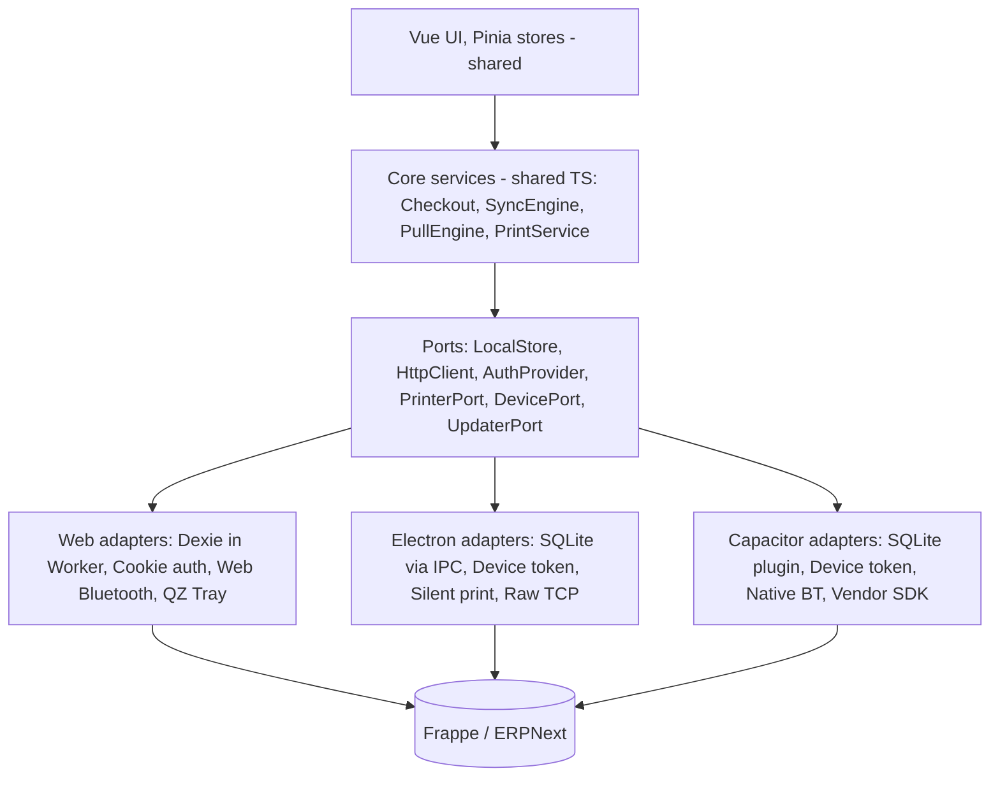
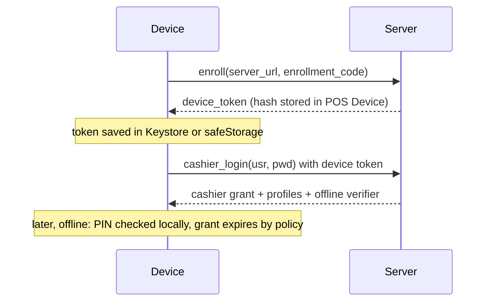

# 02. البنية المستهدفة

الهدف: **واجهة واحدة**، و**محرك مزامنة واحد**، وبيئة تشغيل مختلفة لكل منصة. لا توجد نسخة واجهة خاصة بأي منصة.

## 1. المبادئ

1. **الجهاز يحفظ أولًا دائمًا.** كل بيع يُكتب محليًا في معاملة ذرية قبل الطباعة وقبل أي طلب شبكة، حتى لو كانت الشبكة ممتازة.
2. **مسار بيع واحد.** لا يوجد فرع أونلاين وفرع أوفلاين. الاختلاف الوحيد هو متى يصل الطلب إلى الخادم.
3. **الخادم هو المرجع المحاسبي.** الجهاز مرجع حدوث البيع وما دفعه العميل، والخادم مرجع القيود والمخزون.
4. **لا كود منصة داخل الواجهة.** مكونات Vue والمتاجر تتعامل مع واجهات مجردة فقط.
5. **المرحلة الانتقالية تبقي الويب يعمل.** كل خطوة تُنشر على الويب الحالي قبل بناء المنصات الجديدة.

## 2. الطبقات



## 3. جدول المنصات

| القدرة | الويب PWA | Windows عبر Electron | Android عبر Capacitor |
|---|---|---|---|
| التخزين | IndexedDB عبر Dexie | SQLite عبر `better-sqlite3` | SQLite عبر `@capacitor-community/sqlite` |
| موقع التخزين في التشغيل | Web Worker | Utility process أو main | الخيط الرئيسي يستدعي إضافة أصلية |
| التشفير المحلي | غير متاح فعليًا | SQLCipher، والمفتاح عبر `safeStorage` | SQLCipher، والمفتاح في Android Keystore |
| المصادقة | كوكي الجلسة وCSRF | Device token وجلسة كاشير | Device token وجلسة كاشير |
| الشبكة | `fetch` بمسار نسبي | `fetch` بعنوان كامل | `CapacitorHttp` أو `fetch` بعنوان كامل |
| طباعة إيصال HTML | `/printview` أو QZ | `webContents.print` صامت | مولد ESC/POS المحلي |
| طابعة بلوتوث | Web Bluetooth | Web Bluetooth، وCOM للبلوتوث الكلاسيكي | إضافة BLE وإضافة SPP |
| طابعة USB | WebUSB | Spooler أو WebUSB | USB OTG عبر إضافة |
| طابعة شبكة | QZ Tray | TCP 9100 من العملية الرئيسية | TCP عبر إضافة |
| طابعة مدمجة | لا | لا | SDK الشركة المصنعة، مثل Sunmi |
| التحديث | Service Worker | `electron-updater` | متجر أو MDM، مع تحديث حزمة الويب لاحقًا |
| نسخة واحدة | Web Locks لاختيار تبويب قائد | `requestSingleInstanceLock` | نشاط واحد |

## 4. قرار التخزين

**القرار:** SQLite على Electron وAndroid، وDexie يبقى على الويب خلف الواجهة نفسها.

الويب لا يملك SQLite أصليًا. نقله إلى SQLite WASM يضيف حجمًا وتعقيدًا في OPFS دون حل مشكلة الإزالة كليًا، لأن التخزين يبقى تحت سياسة المتصفح. لذا لا يُعد ذلك جزءًا من الخطة الأولى، ويمكن إضافته لاحقًا كمحرك ثالث دون تغيير الواجهة.

### الواجهة المجردة

الواجهة تكون على مستوى **المستودعات** لا SQL، حتى يمكن تنفيذها بـ Dexie أيضًا.

```ts
// POS/src/platform/ports/LocalStore.ts
export interface LocalStore {
  outbox: OutboxRepo
  catalog: CatalogRepo     // items, prices, stock, taxes, offers
  customers: CustomerRepo
  shifts: ShiftRepo
  receipts: ReceiptRepo    // receipt payloads, must survive restart
  printQueue: PrintQueueRepo
  kv: KvRepo               // critical settings only
  migrate(): Promise<void>
  health(): Promise<StoreHealth>
}

export interface OutboxRepo {
  // Atomic: outbox row + receipt + stock reservation commit together or not at all
  enqueueSale(sale: QueuedSale): Promise<void>
  nextBatch(limit: number, now: number): Promise<OutboxRow[]>
  markSending(ids: string[]): Promise<void>
  applyResult(result: PushResult): Promise<void>
  counts(): Promise<OutboxCounts>
}
```

المحركان الأصليان يشتركان في طبقة SQL واحدة:

```ts
export interface SqlExecutor {
  all<T>(sql: string, params?: unknown[]): Promise<T[]>
  run(sql: string, params?: unknown[]): Promise<void>
  // A list, not a callback: an interactive transaction across the Capacitor bridge is fragile
  batch(statements: { sql: string; params?: unknown[] }[]): Promise<void>
}
```

### أين يعمل التخزين

- **الويب:** يبقى في Worker كما هو الآن.
- **Electron:** لا يُستدعى من الـ Worker، لأن `contextBridge` يعمل على `window` فقط. الاستدعاء يكون من الخيط الرئيسي عبر IPC، و`better-sqlite3` يعمل في utility process حتى لا يعطل الواجهة.
- **Android:** إضافات Capacitor لا تُستدعى من Web Worker. الاستدعاء يكون من الخيط الرئيسي، والعمل الفعلي يجري في الجانب الأصلي خارج خيط الواجهة.

لهذا يتحول `offlineWorker` إلى واجهة تختار المحرك، بدل أن يكون الـ Worker شرطًا في كل المنصات.

### مخطط SQLite الأساسي

يوضع في `POS/src/platform/sql/migrations/` كملفات مرقمة، وكل ترحيل يُطبق مرة واحدة داخل معاملة.

```sql
CREATE TABLE schema_migrations (version INTEGER PRIMARY KEY, applied_at INTEGER NOT NULL);

CREATE TABLE outbox (
  offline_id        TEXT PRIMARY KEY,          -- UUIDv7, stable across every retry
  seq               INTEGER NOT NULL UNIQUE,   -- device FIFO order
  entity            TEXT NOT NULL,             -- invoice | customer | payment | shift_close
  entity_version    INTEGER NOT NULL,
  local_number      TEXT,                      -- printed on the receipt
  payload           TEXT NOT NULL,
  payload_hash      TEXT NOT NULL,
  state             TEXT NOT NULL,             -- see 03-sync-engine.md
  depends_on        TEXT,
  attempts          INTEGER NOT NULL DEFAULT 0,
  next_attempt_at   INTEGER NOT NULL DEFAULT 0,
  last_error_class  TEXT,
  last_error        TEXT,
  server_name       TEXT,
  superseded_by     TEXT,
  shift             TEXT,
  created_at        INTEGER NOT NULL,
  acked_at          INTEGER,
  synced_at         INTEGER
);
CREATE INDEX idx_outbox_due ON outbox(state, next_attempt_at, seq);
CREATE INDEX idx_outbox_shift ON outbox(shift, state);

CREATE TABLE stock_base (item_code TEXT, warehouse TEXT, qty REAL, as_of INTEGER,
                         PRIMARY KEY (item_code, warehouse));
CREATE TABLE stock_reservation (offline_id TEXT, item_code TEXT, warehouse TEXT, stock_qty REAL,
                                PRIMARY KEY (offline_id, item_code, warehouse));
CREATE TABLE sync_cursor (entity TEXT PRIMARY KEY, cursor TEXT, synced_at INTEGER);
CREATE TABLE receipt (offline_id TEXT PRIMARY KEY, doc TEXT NOT NULL, printed_count INTEGER DEFAULT 0);
CREATE TABLE device_sequence (name TEXT PRIMARY KEY, value INTEGER NOT NULL);
```

جداول الأصناف والأسعار والعملاء تحمل عمود `search_text` منسقًا للعربية، بتوحيد الهمزات والتاء المربوطة والألف المقصورة وحذف التشكيل. يُفضل FTS5 إذا أثبتت التجربة S-5 توفره في بناء SQLCipher على Android.

### ما يبقى في `localStorage`

تفضيلات الواجهة تبقى كما هي، لأن `localStorage` يدوم في Electron وWebView، وهذا يوفر تعديل 170 موضعًا. ينتقل إلى `LocalStore` فقط ما يؤثر في صحة العمل:

| الحالي | الموقع | الوجهة |
|---|---|---|
| بيانات الوردية `pos_shift_data` | [useShift.js:39](../../POS/src/composables/useShift.js#L39) | `shifts` |
| الإيصالات المؤقتة | [offlineReceiptCache.js:14](../../POS/src/utils/offline/offlineReceiptCache.js#L14) | `receipts` |
| بيانات الملف الشخصي | [itemSearch.js:2091](../../POS/src/stores/itemSearch.js#L2091) | `catalog` |
| قواعد الضرائب | في الذاكرة فقط | `catalog` |
| hash كلمة المرور | `pos_session_pwd_hash` | تخزين الأسرار في كل منصة |

## 5. الشبكة والمصادقة

### طبقة HTTP

كل الاتصالات تمر عبر `HttpClient` واحد:

- **`createResource`:** يتغير عبر `setConfig("resourceFetcher")` الموجود في [main.js](../../POS/src/main.js).
- **`call`:** يُوحَّد عبر [apiWrapper.js](../../POS/src/utils/apiWrapper.js). توجد 9 ملفات تستورد `call` مباشرة من frappe-ui ويجب تحويلها، لأن النسخة الأصلية تستخدم مسارًا نسبيًا ثابتًا.
- **`fetch` المباشر:** المواضع الستة تتحول إلى `HttpClient`.
- **عنوان الخادم:** يُحفظ عند تسجيل الجهاز. يبقى نسبيًا على الويب.

### تسجيل الجهاز

الكوكي لا تناسب `capacitor://` أو `app://` بسبب قيود SameSite. الحل هو DocType جديد باسم `POS Device`، مع `auth_hooks` الذي يدعمه Frappe في `frappe/auth.py`.

| الحقل | الغرض |
|---|---|
| `device_id` | UUID يُنشأ عند أول تشغيل |
| `device_code` | رمز قصير يظهر في رقم الإيصال |
| `platform`، `app_version`، `last_seen` | المراقبة |
| `token_hash`، `token_expires` | التحقق دون تخزين الرمز نفسه |
| `allowed_profiles` | جدول POS Profiles المسموحة |
| `status` | Active أو Revoked |



- **رمز التسجيل:** يصدره مدير من مكتب الإدارة، لمرة واحدة وصلاحية قصيرة.
- **دخول الكاشير أوفلاين:** رمز PIN يُتحقق منه محليًا بعد دخول واحد ناجح أونلاين على الجهاز.
- **مدة الأوفلاين القصوى:** إعداد في POS Settings، وبعدها يُمنع البيع حتى يتصل الجهاز.
- **هوية الفاتورة:** الخادم يحدد الكاشير من الحمولة، ويتحقق من صلته بالـ POS Profile، ثم يضبط صاحب الفاتورة. هذا يعالج F-16.
- **إبطال الجهاز:** تغيير الحالة إلى Revoked يوقف الوصول فورًا، وتبقى الفواتير المستلمة قبل ذلك.

### البديل الذي استبعدته

`api_key:api_secret` أبسط، لكنها مرتبطة بمستخدم وبلا انتهاء، وتسربها يعطي كل صلاحياته. يبقى OAuth2 من Frappe خيارًا جيدًا إذا طلبتم تسجيل دخول موحدًا.

## 6. الطباعة

`PrintService` مشترك ويبني الإيصال، و`PrinterPort` يرسل البايتات أو HTML.

```ts
export interface PrinterPort {
  capabilities(): PrinterCapabilities
  discover(kind: PrinterKind): Promise<PrinterInfo[]>
  connect(id: string): Promise<void>
  sendRaw(bytes: Uint8Array): Promise<void>    // ESC/POS
  printHtml?(html: string, opts: PrintOptions): Promise<void>
  openCashDrawer?(): Promise<void>
}
```

- **إعادة الاستخدام:** [escpos.ts](../../POS/src/utils/escpos.ts) و[printerQueue.ts](../../POS/src/services/printerQueue.ts) يبقيان مشتركين. الفرع الحالي `feature/bluetooth-printer` قريب من هذا الفصل ويجب إكماله قبل التحويل.
- **الفصل عن Dexie:** `printerQueue.ts` يستورد قاعدة البيانات مباشرة، ويجب أن يمر عبر `printQueue`.
- **العربية في ESC/POS:** كثير من الطابعات الحرارية لا تدعم تشكيل العربية نصًا، فتبقى الطباعة كصورة الخيار الافتراضي.
- **إيصال قبل المزامنة:** يُبنى من `receipts` بلا خادم، ولا يعتمد على `/printview`.

## 7. البناء وهيكل المجلدات

```text
POS/
  src/
    platform/
      ports/            # interfaces only
      web/              # Dexie, cookie auth, Web Bluetooth, QZ
      electron/         # IPC client adapters
      capacitor/        # plugin adapters
      sql/              # shared repositories + migrations
      index.ts          # picks adapters by __PLATFORM__ via dynamic import
    core/
      checkout/         # single sale path + payload builder
      sync/             # SyncEngine, PullEngine, classifier
  desktop/              # Electron main, preload, utility process, electron-builder config
  android/              # Generated Capacitor project
  capacitor.config.ts
pos_next/
  api/sync.py           # push, pull, status
  api/device.py         # enroll, cashier login
  services/invoice_processor.py
  services/sync_inbox.py
  tasks/sync.py
```

| الوضع | الأمر | الاختلافات |
|---|---|---|
| web | `vite build --mode web` | `base=/assets/pos_next/pos/`، مع PWA وjinjaBootData |
| electron | `vite build --mode electron` | `base=./`، بلا PWA، ولا إعداد خاص بالبنش |
| android | `vite build --mode android` | `base=/`، بلا PWA |

تعديلات مطلوبة في الكود المشترك:

- [socket.js:2](../../POS/src/socket.js#L2) يأخذ الإعداد من `runtimeConfig` بدل ملف داخل البنش.
- [router.js:25](../../POS/src/router.js#L25) يأخذ الأساس من `import.meta.env`.
- `target: "es2015"` يبقى للويب فقط، وتستخدم المنصات الأصلية هدفًا أحدث.
- [POSSale.vue:2577](../../POS/src/pages/POSSale.vue#L2577) يخفي الانتقال إلى `/app` خارج الويب.

## 8. Electron

- **الأمان:** `contextIsolation: true` و`nodeIntegration: false` و`sandbox: true`، مع CSP صارم وقائمة IPC محددة.
- **تحميل الواجهة:** بروتوكول `app://` عبر `protocol.handle` مع رجوع إلى `index.html`.
- **الأجهزة:** معالجة `select-bluetooth-device` و`select-usb-device` و`setDevicePermissionHandler` لتجنب نوافذ اختيار كل مرة. الصلاحيات تُحفظ لأن الافتراضي ينتهي مع `WebContents`.
- **SQLite:** `better-sqlite3` وحدة أصلية تحتاج إعادة بناء لكل إصدار Electron، ويُعالج ذلك بـ `electron-builder install-app-deps` في CI. للتشفير يُجرب `better-sqlite3-multiple-ciphers` في S-2.
- **الإغلاق:** تنبيه إذا كانت هناك فواتير غير مرفوعة، مع إبقاء التطبيق في شريط النظام.
- **التوقيع:** توقيع الكود ضروري لتجنب تحذير SmartScreen، ويحتاج شهادة مدفوعة.
- **التوزيع:** `electron-updater` من خادم تتحكمون به.
- **نقطة البداية:** الطباعة الصامتة وإعدادات المثبت وبناء الواجهة في [POS/desktop](../../POS/desktop/README.md).
- **ما استُبعد:** خادم Express في فرع BrainWise، لأنه يكرر واجهات Frappe بلغة JavaScript، ولا يعمل على Android.

## 9. Android

- **السبب في عدم استخدام `server.url`:** تحميل الواجهة من الخادم يمنع البدء أوفلاين، لذا تُحزم الواجهة داخل التطبيق.
- **SQLite:** `@capacitor-community/sqlite` المرشح الأول. مصادر مراجعتي ثانوية، لذا توافق الإصدار مع Capacitor يُؤكد في S-1.
- **مفتاح التشفير:** الإضافة تستخدم سرًا واحدًا لكل القواعد، وهذا يكفي هنا لأن للتطبيق قاعدة واحدة، ويُولد عشوائيًا لكل جهاز ويُخزن في Keystore.
- **البلوتوث:** لا تعتمدوا على Web Bluetooth في WebView. نحتاج `@capacitor-community/bluetooth-le` لطابعات BLE، وإضافة SPP لطابعات البلوتوث الكلاسيكي الشائعة.
- **المزامنة:** تعمل في الواجهة. WorkManager اختياري لاحقًا لرفع الفواتير والتطبيق في الخلفية.
- **أجهزة POS:** طابعات Sunmi وiMin المدمجة تحتاج إضافة صغيرة حول SDK الشركة.

## 10. الأمان

| الموضوع | الإجراء |
|---|---|
| حماية الفاتورة في الخادم | قائمة DocType مسموحة وتحقق من صلة المستخدم بالـ POS Profile والوردية |
| التشفير المحلي | SQLCipher على المنصات الأصلية |
| الويب | عدم تخزين أسرار، وتحذير عند التشغيل على جهاز مشترك |
| سلامة الحمولة | `payload_hash` وفحص الأذونات للجهاز |
| تعديل الفواتير من الجهاز | أي حمولة جديدة بنفس `offline_id` ترفض ما لم تكن مطابقة |
| النسخ الاحتياطي | تصدير مشفر للـ outbox من شاشة الدعم، ومنع الحذف ما لم يتأكد الرفع |
| الترخيص | التطبيق AGPL-3.0، وتوزيع exe وAPK يستلزم إتاحة المصدر المقابل |

## 11. الامتثال الضريبي

يوجد على هذا البنش تطبيق `ksa_compliance`، ويعمل عند `on_submit` لفواتير المبيعات وPOS، أي **في الخادم وبعد المزامنة**. وهذا يعني أن إيصال الأوفلاين لا يحمل بيانات ZATCA النهائية.

المصادر الثانوية التي راجعتها تذكر الإبلاغ عن الفواتير المبسطة خلال 24 ساعة من الإصدار، وختمًا مشفرًا من حل المكلف، لكنها لا تحسم حالة نقطة البيع المنقطعة. لذلك هذا قرار امتثال لا قرار برمجي، ويجب تأكيده مع مستشار ضريبي ومع وثائق Fatoora الرسمية.

**الافتراض في الخطة:** الوضع اللحظي هو الافتراضي في الملفات الخاضعة لـ ZATCA، ويطبع الرمز النهائي إن وصل الرد في المهلة. عند الانقطاع يُعد الإيصال مؤقتًا ويُعرض بوضوح، وتنبيه إداري عند اقتراب 24 ساعة دون رفع.

توقيع الفواتير محليًا على الجهاز ممكن تقنيًا، لكنه يحتاج شهادة لكل جهاز وسلسلة hash محلية، ولا يدخل في هذه الخطة دون قرار صريح.

## 12. المصادر

- [Electron: Device Access](https://www.electronjs.org/docs/latest/tutorial/devices)
- [مقارنة إضافات SQLite لـ Capacitor، مصدر تجاري](https://capgo.app/blog/capacitor-community-sqlite-alternative/)
- [نقاش استخدام إضافات Capacitor داخل Worker](https://forum.ionicframework.com/t/use-capacitor-plugin-in-web-worker/188816)
- [ملاحظات إعادة بناء better-sqlite3 مع Electron](https://docs.triliumnotes.org/developer-guide/dependencies/updating-deps/bettersqlite-binaries)
- [Daftra: ZATCA Phase 2](https://www.daftra.com/en/hub/zatca-einvoicing-phase-2)
- [Dariba: Saudi E-Invoicing Phase 2](https://www.dariba.co/saudi-e-invoicing-phase-2/)
