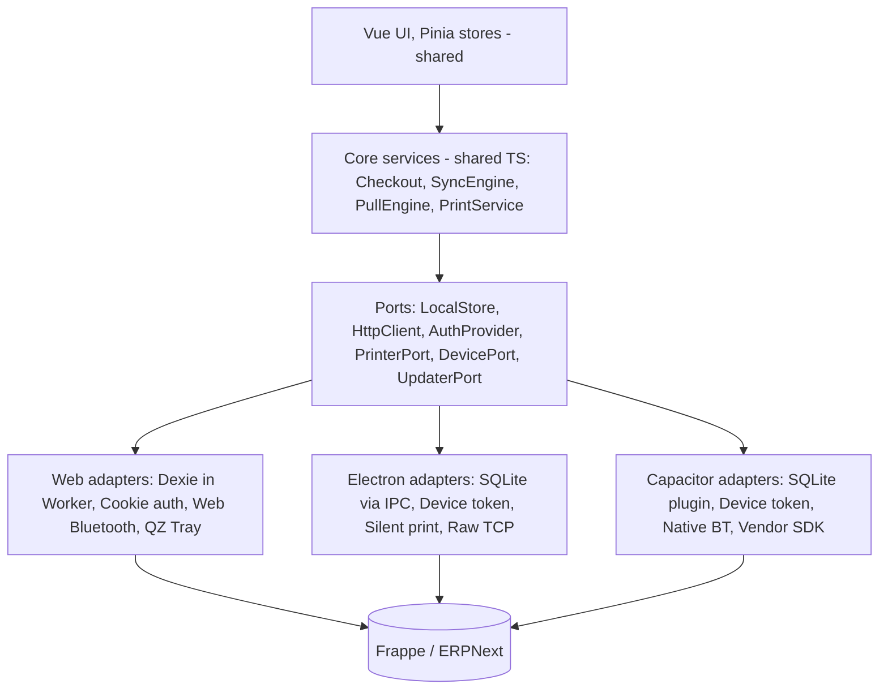
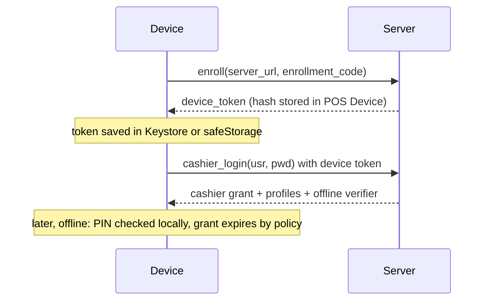

# 02. البنية المستهدفة

الهدف: **واجهة واحدة**، و**محرك مزامنة واحد**، وبيئة تشغيل مختلفة لكل منصة. لا توجد نسخة واجهة خاصة بأي منصة.

## 1. المبادئ

1. **الجهاز يحفظ أولًا دائمًا.** كل بيع يُكتب محليًا في معاملة ذرية قبل الطباعة وقبل أي طلب شبكة، حتى لو كانت الشبكة ممتازة.
2. **مسار بيع واحد.** لا يوجد فرع أونلاين وفرع أوفلاين. الاختلاف الوحيد هو متى يصل الطلب إلى الخادم.
3. **الخادم هو المرجع المحاسبي.** الجهاز مرجع حدوث البيع وما دفعه العميل، والخادم مرجع القيود والمخزون.
4. **لا كود منصة داخل الواجهة.** مكونات Vue والمتاجر تتعامل مع واجهات مجردة فقط.
5. **المرحلة الانتقالية تبقي الويب يعمل.** كل خطوة تُنشر على الويب الحالي قبل بناء المنصات الجديدة.

## 2. الطبقات



## 3. جدول المنصات

| القدرة | الويب PWA | Windows عبر Electron | Android عبر Capacitor |
|---|---|---|---|
| التخزين | IndexedDB عبر Dexie | SQLite عبر `better-sqlite3-multiple-ciphers` | SQLite عبر `@capacitor-community/sqlite` |
| موقع التخزين في التشغيل | Web Worker | Utility process أو main | الخيط الرئيسي يستدعي إضافة أصلية |
| التشفير المحلي | غير متاح فعليًا | صيغة SQLCipher 4، والمفتاح عبر `safeStorage` | SQLCipher، والمفتاح تحت Android Keystore |
| المصادقة | كوكي الجلسة وCSRF | Device token وجلسة كاشير | Device token وجلسة كاشير |
| الشبكة | `fetch` بمسار نسبي | `fetch` بعنوان كامل | `CapacitorHttp` أو `fetch` بعنوان كامل |
| الطباعة | بلوتوث، أو QZ بطابعة افتراضية، أو نافذة Chrome | طابعة محددة في الإعدادات، أو نافذة طابعات النظام | بلوتوث، أو طابعة Wi-Fi عبر TCP 9100 |
| التحديث | Service Worker | `electron-updater` | متجر أو MDM، مع تحديث حزمة الويب لاحقًا |
| نسخة واحدة | Web Locks لاختيار تبويب قائد | `requestSingleInstanceLock` | نشاط واحد |

## 4. قرار التخزين

**القرار:** SQLite على Electron وAndroid، وDexie يبقى على الويب خلف الواجهة نفسها.

الويب لا يملك SQLite أصليًا. نقله إلى SQLite WASM يضيف حجمًا وتعقيدًا في OPFS دون حل مشكلة الإزالة كليًا، لأن التخزين يبقى تحت سياسة المتصفح. لذا لا يُعد ذلك جزءًا من الخطة الأولى، ويمكن إضافته لاحقًا كمحرك ثالث دون تغيير الواجهة.

### واجهة التخزين

خططت أولًا لواجهة مستودعات باسم `LocalStore`. بنيت بدلها واجهة مسطحة واحدة، لأن كل نداءات التطبيق كانت تمر عبر `offlineWorker`، ونقلها إلى مستودعات كان سيعدل كل موضع دون فائدة للمستخدم.

| الجزء | الموقع |
|---|---|
| قائمة الدوال وشكل الصف | `POS/src/platform/store/methods.js` |
| اختيار التنفيذ وقت البناء، فلا يدخل كود منصة في حزمة أخرى | `POS/src/platform/store/index.js` |
| تنفيذ الويب: Dexie في Worker، وما كان على الخيط الرئيسي يبقى عليه | `POS/src/platform/store/web.js` |
| التنفيذ الأصلي | `POS/src/platform/store/native.js` و`sqlStore.js` |
| مستودعات SQL المشتركة بين Electron وAndroid | `POS/src/platform/sql/` |

مجموعة عقد واحدة، `store/__tests__/contract.test.js`، تشغّل نفس الاختبارات على كل التنفيذات، فاختلاف السلوك بين الويب وSQLite يظهر كفشل اختبار. الشكل الذي يصل إلى التطبيق واحد: `toQueuedInvoice` في `platform/sql/outbox.js` يحوّل صف SQLite إلى شكل صف الويب.

المحركان الأصليان يشتركان في طبقة SQL واحدة:

```ts
export interface SqlExecutor {
  all<T>(sql: string, params?: unknown[]): Promise<T[]>
  run(sql: string, params?: unknown[]): Promise<void>
  // A list, not a callback: an interactive transaction across the Capacitor bridge is fragile
  batch(statements: { sql: string; params?: unknown[] }[]): Promise<void>
}
```

### أين يعمل التخزين

- **الويب:** يبقى في Worker كما هو الآن.
- **Electron:** لا يُستدعى من الـ Worker، لأن `contextBridge` يعمل على `window` فقط. الاستدعاء يكون من الخيط الرئيسي عبر IPC، ومحرك SQLite يعمل في utility process حتى لا يعطل الواجهة.
- **Android:** إضافات Capacitor لا تُستدعى من Web Worker. الاستدعاء يكون من الخيط الرئيسي، والعمل الفعلي يجري في الجانب الأصلي خارج خيط الواجهة.

لهذا لا يكون الـ Worker شرطًا في كل المنصات: الويب وحده يستخدمه.

### مخطط SQLite الأساسي

الترحيلات في ملف واحد، `POS/src/platform/sql/migrations.js`، وكل ترحيل يُطبق مرة واحدة داخل معاملة ويُسجل في `schema_migrations`.

```sql
CREATE TABLE outbox (
  offline_id      TEXT PRIMARY KEY,          -- stable across every retry
  seq             INTEGER NOT NULL UNIQUE,   -- device FIFO order
  entity          TEXT NOT NULL,             -- invoice | customer | payment | shift_close
  entity_version  INTEGER NOT NULL,
  local_number    TEXT,                      -- printed on the receipt
  payload         TEXT NOT NULL,
  state           TEXT NOT NULL,             -- see 03-sync-engine.md
  depends_on      TEXT,
  attempts        INTEGER NOT NULL DEFAULT 0,
  next_attempt_at INTEGER NOT NULL DEFAULT 0,
  last_error      TEXT,
  server_name     TEXT,
  superseded_by   TEXT,
  shift           TEXT,
  created_at      INTEGER NOT NULL,
  acked_at        INTEGER,
  synced_at       INTEGER,
  sync_failed     INTEGER NOT NULL DEFAULT 0  -- migration 2
);
```

| الترحيل | الجداول |
|---|---|
| 1 | `outbox` و`stock_base` و`stock_reservation` و`receipt` و`device_sequence` و`sync_cursor` و`kv` |
| 2 | `catalog_item` و`item_barcode` و`item_price` و`customer` و`payment_method` و`sales_person` و`offer` و`invoice_history` و`unpaid_invoice` و`translation` و`draft` و`current_shift` و`print_job` |

بصمة الحمولة وفئة الخطأ لم تدخلا الجهاز: الخادم يحسبهما عند الاستلام، فلا فائدة من تكرارهما.

البحث بلا FTS5. `catalog_item` يحمل `search_code` و`search_name` و`search_text` بعد توحيد الهمزات والتاء المربوطة والألف المقصورة وحذف التشكيل (`sql/searchText.js`). المطابقة التامة والبادئة تستخدمان الفهرس، وبحث الجزء من الكلمة يمر على الصفوف. على 50 ألف صنف قِسته بين 60 و118 مللي ثانية على هذا الخادم بـ `better-sqlite3`، أي أن هدف 100 مللي ثانية لا يتحقق دائمًا. لم يُقس على Android، والفرق هناك يُحسم في S-5.

### ما يبقى في `localStorage`

تفضيلات الواجهة تبقى كما هي، لأن `localStorage` يدوم في Electron وWebView، وهذا يوفر تعديل 170 موضعًا. ينتقل إلى `LocalStore` فقط ما يؤثر في صحة العمل:

| الحالي | الموقع | الوجهة |
|---|---|---|
| بيانات الوردية `pos_shift_data` | [useShift.js:39](../../POS/src/composables/useShift.js#L39) | `shifts` |
| الإيصالات المؤقتة | [offlineReceiptCache.js:14](../../POS/src/utils/offline/offlineReceiptCache.js#L14) | `receipts` |
| بيانات الملف الشخصي | [itemSearch.js:2091](../../POS/src/stores/itemSearch.js#L2091) | `catalog` |
| قواعد الضرائب | في الذاكرة فقط | `catalog` |
| hash كلمة المرور | `pos_session_pwd_hash` | تخزين الأسرار في كل منصة |

### تشفير القاعدة

ملف SQLite على Electron وAndroid مشفر، حتى لا يكشف جهاز مسروق بيانات العملاء والمبيعات. المفتاح عشوائي بطول 256 بت لكل جهاز، يُولد مرة واحدة، ولا يدخل `localStorage` ولا السجلات. الويب خارج هذا، كما في جدول المنصات.

| | Electron | Android |
|---|---|---|
| المحرك | `better-sqlite3-multiple-ciphers` بصيغة SQLCipher 4 | SQLCipher داخل `@capacitor-community/sqlite` |
| الملف | `pos-next.sqlite` في مجلد بيانات التطبيق | `pos_next_secureSQLite.db` |
| مكان المفتاح | `pos_next_database_key` في `secrets.json`، مشفرًا بـ `safeStorage` | `pos_next_database_secret` في `capacitor-secure-storage-plugin`، ونسخة في تفضيلات الإضافة المشفرة |
| من يراه | العملية الرئيسية وعملية القاعدة، ويصلها برسالة لا بسطر الأوامر. الصفحة تُرفض إن طلبته | واجهة WebView، لأنها هي التي تستدعي الإضافة |

صيغة SQLCipher محددة صراحة على Electron، حتى لا يقفل تغيير الإعداد الافتراضي للمكتبة ملفًا قائمًا، وحتى تفتحه أدوات SQLCipher القياسية إذا توفر المفتاح. جربت ذلك بـ SQLCipher 4.12 مستقلًا.

**على Android مفتاحان لسر واحد، وهذا مقصود.** الإضافة تحفظ السر بـ `apply()`، فيصل إلى القرص بعد عودة النداء، وقتل العملية في تلك اللحظة يترك ملفًا مشفرًا بسر ضاع. لذا يُحفظ السر أولًا في تخزين الأسرار، الذي يكتب فورًا، ويُقرأ للتأكد، ثم يصل إلى الإضافة. وكل نداء إضافة يحمل قيمه، فسجلات Capacitor معطلة بـ `loggingBehavior: "none"`، وإلا كتبت نسخة debug السر في logcat.

**تحويل قاعدة قديمة غير مشفرة.** يحدث عند أول تشغيل بعد التحديث، والأصل يبقى كاملًا ومقروءًا حتى اللحظة الأخيرة. نسخة جديدة تُبنى إلى جانبه، ثم تُقارن معه جدولًا جدولًا وصفًا صفًا، ثم يتم الانتقال بخطوة واحدة:

| | Electron | Android |
|---|---|---|
| بناء النسخة | دمج `-wal` في الملف، ثم `VACUUM INTO` إلى `pos-next.sqlite.encrypting`، ثم `rekey` | `ATTACH ... KEY ''` و`sqlcipher_export` في قاعدة جديدة |
| لحظة الانتقال | `rename` فوق الملف القديم، بعد `fsync` | صف أخير في القاعدة الجديدة، `encrypted_copy_done` |
| ما بعدها | لا شيء | حذف الملف القديم، ويُعاد في التشغيل التالي إن تعذر |

لم أستخدم وضع `encryption` في الإضافة، لأنه يحذف الأصل ثم ينقل الملف الجديد مكانه، فقتل العملية بينهما يضيع كل المبيعات، ولأن الملف المؤقت في مجلد الكاش. ودمج `-wal` شرط لا تحسين: فيه مبيعات لم تصل إلى الملف الرئيسي، ولو بقي بجانب الملف المشفر لأعاد SQLite تطبيقه عليه.

إذا فشل التحويل لأي سبب، مثل قرص ممتلئ، يعمل التطبيق على الملف القديم كما كان، ويظهر تنبيه للكاشير، ويعيد المحاولة في التشغيل التالي. لا خطر على أي بيع، ولا معنى لإيقاف المتجر بسبب ذلك. أما جهاز جديد بلا تخزين آمن فلا ينشئ قاعدة غير مشفرة، بل يتوقف.

**قاعدة لا تفتح.** قاعدة موجودة لا تُقرأ ليست قاعدة فارغة. إذا وُجد ملف مشفر وتعذر المفتاح، أو رفضه الملف:

- لا يُولد مفتاح جديد، ولا يُحذف الملف، ولا يُنقل.
- لا يبدأ شيء من التطبيق، ولا تسجيل الدخول: تظهر صفحة `pages/DatabaseLocked.vue` وحدها، ومعها رمز للدعم وزر **Try again**.
- كل استدعاء للقاعدة يفشل بـ `DatabaseLockedError`، ولا يعيد قيمة الرجوع الفارغة في `createNativeStore`، فلا تظهر شاشات فارغة تبدو كأن لا مبيعات.
- الزر يعيد القراءة من القرص، فعودة المفتاح تكفي دون أي خطوة أخرى.

الترجمات في القاعدة المقفلة نفسها، لذا يحفظ كل تشغيل طبيعي نصوص الصفحة باللغة الحالية في `localStorage`، وليس فيها شيء سري. خطوات الاسترجاع في [07](07-operations-guide.md) القسم 3.

**حدود التشفير.** يحمي الملف إذا نُسخ أو سُرق القرص، ولا يحمي من شخص يدخل بحساب Windows نفسه، لأن `safeStorage` يفك المفتاح لأي برنامج يعمل بذلك الحساب. وملفات SQLite المؤقتة غير مشفرة على Electron، لذا `temp_store = MEMORY`.

## 5. الشبكة والمصادقة

### طبقة HTTP

كل الطلبات تنتهي في `fetch`، سواء من frappe-ui أو من كودنا. لذلك يكفي جسر واحد في [http.js](../../POS/src/platform/http.js) يعمل على exe وAndroid فقط، ويضيف عنوان الخادم ورمز الجهاز. وهذا أبسط من الخطة الأولى التي كانت تعدل أكثر من 150 موضعًا.

عنوان الخادم يُحفظ عند تسجيل الجهاز، ويبقى نسبيًا على الويب.

### تسجيل الجهاز

الكوكي لا تناسب `capacitor://` أو `app://` بسبب قيود SameSite. الحل هو DocType جديد باسم `POS Device`، مع `POS Enrollment Code` لرموز التسجيل، و`auth_hooks` الذي يدعمه Frappe في `frappe/auth.py`.

للجهاز سرّان. **رمز الجهاز** طويل العمر، ويُرسل فقط إلى `cashier_login` في الترويسة `X-POS-Device-Token`. و**تفويض الكاشير** مدته 12 ساعة، ويُرسل مع كل طلب كـ Bearer، فيعمل الطلب بصلاحيات الكاشير لا أكثر. لا يصلح رمز الجهاز كـ Bearer، لأن Frappe ينهي أي طلب يبقى بعده الزائر Guest.

**شرط نشر:** يجب أن يتضمن `allow_cors` في إعدادات الموقع `app://pos` و`https://localhost`، وإلا تفشل كل طلبات التطبيقين.

| الحقل | الغرض |
|---|---|
| `device_id` | UUID يُنشأ عند أول تشغيل |
| `device_code` | رمز قصير يظهر في رقم الإيصال |
| `platform`، `app_version`، `last_seen` | المراقبة |
| `token_hash`، `token_expires` | التحقق دون تخزين الرمز نفسه |
| `cashier`، `grant_hash`، `grant_expires` | جلسة الكاشير الحالية على الجهاز |
| `allowed_profiles` | جدول POS Profiles المسموحة |
| `status` | Active أو Revoked |



- **رمز التسجيل:** يصدره مدير من مكتب الإدارة، لمرة واحدة وصلاحية قصيرة.
- **دخول الكاشير أوفلاين:** رمز PIN يُتحقق منه محليًا بعد دخول واحد ناجح أونلاين على الجهاز.
- **مدة الأوفلاين القصوى:** إعداد في POS Settings، وبعدها يُمنع البيع حتى يتصل الجهاز.
- **هوية الفاتورة:** الخادم يحدد الكاشير من الحمولة، ويتحقق من صلته بالـ POS Profile، ثم يضبط صاحب الفاتورة. هذا يعالج F-16.
- **إبطال الجهاز:** تغيير الحالة إلى Revoked يوقف الوصول فورًا، وتبقى الفواتير المستلمة قبل ذلك.

### البديل الذي استبعدته

`api_key:api_secret` أبسط، لكنها مرتبطة بمستخدم وبلا انتهاء، وتسربها يعطي كل صلاحياته. يبقى OAuth2 من Frappe خيارًا جيدًا إذا طلبتم تسجيل دخول موحدًا.

## 6. الطباعة

قرار الفريق حسب المنصة، والقاعدة في [routes.js](../../POS/src/platform/printing/routes.js):

| المنصة | الطرق بالترتيب | إذا فشلت |
|---|---|---|
| الويب | بلوتوث، ثم QZ Tray بالطابعة الافتراضية، ثم نافذة Chrome | ينتقل للطريقة التالية |
| سطح المكتب | الطابعة المحددة في الإعدادات، وبدونها نافذة طابعات النظام | رسالة خطأ |
| Android | طابعة بلوتوث أو Wi-Fi مقترنة | رسالة تطلب إقران طابعة |

- **إعادة الاستخدام:** [escpos.ts](../../POS/src/utils/escpos.ts) و[printerQueue.ts](../../POS/src/services/printerQueue.ts) يبقيان مشتركين.
- **Android:** لا تعتمدوا على Web Bluetooth في WebView. نحتاج إضافة أصلية للبلوتوث، وإضافة TCP لطابعات Wi-Fi.
- **العربية في ESC/POS:** كثير من الطابعات الحرارية لا تدعم تشكيل العربية نصًا، فتبقى الطباعة كصورة الخيار الافتراضي.
- **إيصال قبل المزامنة:** يُبنى من البيانات المحلية بلا خادم، ولا يعتمد على `/printview`.

## 7. البناء وهيكل المجلدات

```text
POS/
  src/
    platform/
      ports/            # interfaces only
      web/              # Dexie, cookie auth, Web Bluetooth, QZ
      electron/         # IPC client adapters
      capacitor/        # plugin adapters
      sql/              # shared repositories + migrations
      index.ts          # picks adapters by __PLATFORM__ via dynamic import
    core/
      checkout/         # single sale path + payload builder
      sync/             # SyncEngine, PullEngine, classifier
  desktop/              # Electron main, preload, utility process, electron-builder config
  android/              # Generated Capacitor project
  capacitor.config.ts
pos_next/
  api/sync.py           # push, pull, status
  api/device.py         # enroll, cashier login
  services/invoice_processor.py
  services/sync_inbox.py
  tasks/sync.py
```

| الوضع | الأمر | الاختلافات |
|---|---|---|
| web | `vite build --mode web` | `base=/assets/pos_next/pos/`، مع PWA وjinjaBootData |
| electron | `vite build --config desktop/vite.config.electron.mjs` | `base=./`، بلا PWA، ولا إعداد خاص بالبنش |
| android | `vite build --config vite.config.android.mjs` | `base=/`، بلا PWA، والناتج في `POS/dist-android` |

تعديلات مطلوبة في الكود المشترك:

- [socket.js](../../POS/src/socket.js) لا يتصل على المنصات الأصلية، لأن خادم Frappe اللحظي لا يقبل تفويض Bearer من صفحة بأصل مختلف. السحب يقوم مقامه، والمخزون منه كل دقيقة.
- [router.js:25](../../POS/src/router.js#L25) يأخذ الأساس من `import.meta.env`.
- `target: "es2015"` يبقى للويب فقط، وتستخدم المنصات الأصلية هدفًا أحدث.
- [POSSale.vue:2577](../../POS/src/pages/POSSale.vue#L2577) يخفي الانتقال إلى `/app` خارج الويب.

## 8. Electron

- **الأمان:** `contextIsolation: true` و`nodeIntegration: false` و`sandbox: true`، مع CSP صارم وقائمة IPC محددة.
- **تحميل الواجهة:** بروتوكول `app://` عبر `protocol.handle` مع رجوع إلى `index.html`.
- **SQLite:** `better-sqlite3-multiple-ciphers` مثبتة على 12.11.1، وهي وحدة أصلية تحتاج إعادة بناء لكل إصدار Electron، ويُعالج ذلك بـ `electron-builder install-app-deps` في CI. الإصدار 13 لا يصلح مع Electron 33: يحتاج Node أحدث مما فيه، وتتوقف العملية عند تحميله بخطأ segmentation fault. عند رفع Electron راجع هذا القيد. خطوة في `build-windows.yml` تشغل التشفير داخل Electron على Windows قبل البناء.
- **الإغلاق:** تنبيه إذا كانت هناك فواتير غير مرفوعة، مع إبقاء التطبيق في شريط النظام.
- **التوقيع:** توقيع الكود ضروري لتجنب تحذير SmartScreen، ويحتاج شهادة مدفوعة.
- **التوزيع:** `electron-updater` من خادم تتحكمون به.
- **نقطة البداية:** الطباعة الصامتة وإعدادات المثبت وبناء الواجهة في [POS/desktop](../../POS/desktop/README.md).
- **ما استُبعد:** خادم Express في فرع BrainWise، لأنه يكرر واجهات Frappe بلغة JavaScript، ولا يعمل على Android.

## 9. Android

- **السبب في عدم استخدام `server.url`:** تحميل الواجهة من الخادم يمنع البدء أوفلاين، لذا تُحزم الواجهة داخل التطبيق.
- **معرّفات الطابعات:** `ble:` و`spp:` و`tcp:host:port`. طابعة البلوتوث الكلاسيكي تُقرن من إعدادات Android أولًا، ثم تُختار في التطبيق.
- **الرجوع:** زر الرجوع يصغّر التطبيق ولا يغلقه، حتى تبقى السلة والمزامنة. وAndroid لا يعطي إشارة عند سحب التطبيق وإغلاقه.
- **SQLite:** `@capacitor-community/sqlite` 8.1.1 مع Capacitor 8، وينبني بـ gradle. لم يُشغَّل على جهاز بعد، فتجربة S-1 ما زالت قائمة.
- **مفتاح التشفير:** الإضافة تستخدم سرًا واحدًا لكل القواعد، وهذا يكفي هنا لأن للتطبيق قاعدة واحدة. يُولد عشوائيًا لكل جهاز، ويجب أن يصلها بـ `setEncryptionSecret` قبل أول فتح مشفر. التفاصيل في [القسم 4](#تشفير-القاعدة).
- **الطباعة:** بلوتوث عبر `@capacitor-community/bluetooth-le` لطابعات BLE وإضافة SPP للبلوتوث الكلاسيكي، وWi-Fi عبر TCP 9100.
- **المزامنة:** تعمل في الواجهة. WorkManager اختياري لاحقًا لرفع الفواتير والتطبيق في الخلفية.

## 10. الأمان

| الموضوع | الإجراء |
|---|---|
| حماية الفاتورة في الخادم | قائمة DocType مسموحة وتحقق من صلة المستخدم بالـ POS Profile والوردية |
| التشفير المحلي | صيغة SQLCipher على المنصات الأصلية، بمفتاح عشوائي لكل جهاز. انظر [القسم 4](#تشفير-القاعدة) |
| قاعدة لا تفتح | توقف برسالة ورمز، دون حذف ولا بدء من فراغ |
| الويب | عدم تخزين أسرار، وتحذير عند التشغيل على جهاز مشترك |
| سلامة الحمولة | `payload_hash` وفحص الأذونات للجهاز |
| تعديل الفواتير من الجهاز | أي حمولة جديدة بنفس `offline_id` ترفض ما لم تكن مطابقة |
| النسخ الاحتياطي | معطل على Android، فلا تنتقل بيانات الجهاز ولا هويته إلى جهاز آخر |
| تصدير الطابور | ملف JSON غير مشفر يحمل نفس ما يرسله `push`، بعد تأكيد صريح أن فيه بيانات عملاء. لا يغيّر التصدير الطابور، والحذف يبقى مرهونًا بتأكيد الخادم. التفاصيل في [07](07-operations-guide.md) القسم 3 |
| استيراد الطابور | لـ `Nexus POS Manager` و`System Manager`، ويتحقق الخادم من ذلك. كل صف يمر بفحوص `push` و`ingest` نفسها، و`uploaded_by` هو المدير. الملف لا يُحفظ |
| ملف عُدل قبل الاستيراد | محتواه ادعاء. الكاشير يقرره `_resolve_cashier`، ورقم الجهاز مجرد تسمية، ولا يصل الملف إلى حالة السجل ولا إلى ما يتجاوز المراجعة. لكنه يستطيع إضافة مبيعات أو تغييرها قبل أول استيراد، بصلاحيات من يستورده |
| الترخيص | التطبيق AGPL-3.0، وتوزيع exe وAPK يستلزم إتاحة المصدر المقابل |

## 11. الامتثال الضريبي

يوجد على هذا البنش تطبيق `ksa_compliance`، ويعمل عند `on_submit` لفواتير المبيعات وPOS، أي **في الخادم وبعد المزامنة**. وهذا يعني أن إيصال الأوفلاين لا يحمل بيانات ZATCA النهائية.

المصادر الثانوية التي راجعتها تذكر الإبلاغ عن الفواتير المبسطة خلال 24 ساعة من الإصدار، وختمًا مشفرًا من حل المكلف، لكنها لا تحسم حالة نقطة البيع المنقطعة. لذلك هذا قرار امتثال لا قرار برمجي، ويجب تأكيده مع مستشار ضريبي ومع وثائق Fatoora الرسمية.

**الافتراض في الخطة:** الوضع اللحظي هو الافتراضي في الملفات الخاضعة لـ ZATCA، ويطبع الرمز النهائي إن وصل الرد في المهلة. عند الانقطاع يُعد الإيصال مؤقتًا ويُعرض بوضوح، وتنبيه إداري عند اقتراب 24 ساعة دون رفع.

توقيع الفواتير محليًا على الجهاز ممكن تقنيًا، لكنه يحتاج شهادة لكل جهاز وسلسلة hash محلية، ولا يدخل في هذه الخطة دون قرار صريح.

## 12. المصادر

- [Electron: Device Access](https://www.electronjs.org/docs/latest/tutorial/devices)
- [مقارنة إضافات SQLite لـ Capacitor، مصدر تجاري](https://capgo.app/blog/capacitor-community-sqlite-alternative/)
- [نقاش استخدام إضافات Capacitor داخل Worker](https://forum.ionicframework.com/t/use-capacitor-plugin-in-web-worker/188816)
- [ملاحظات إعادة بناء better-sqlite3 مع Electron](https://docs.triliumnotes.org/developer-guide/dependencies/updating-deps/bettersqlite-binaries)
- [Daftra: ZATCA Phase 2](https://www.daftra.com/en/hub/zatca-einvoicing-phase-2)
- [Dariba: Saudi E-Invoicing Phase 2](https://www.dariba.co/saudi-e-invoicing-phase-2/)
