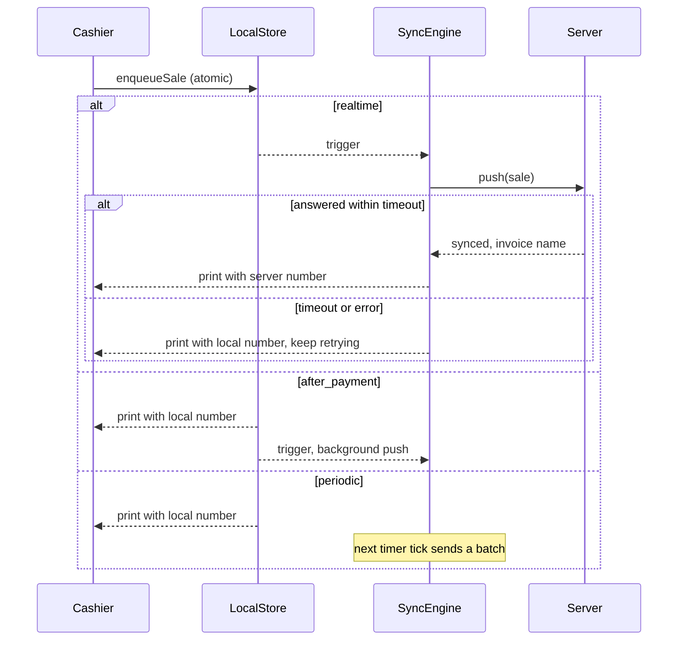
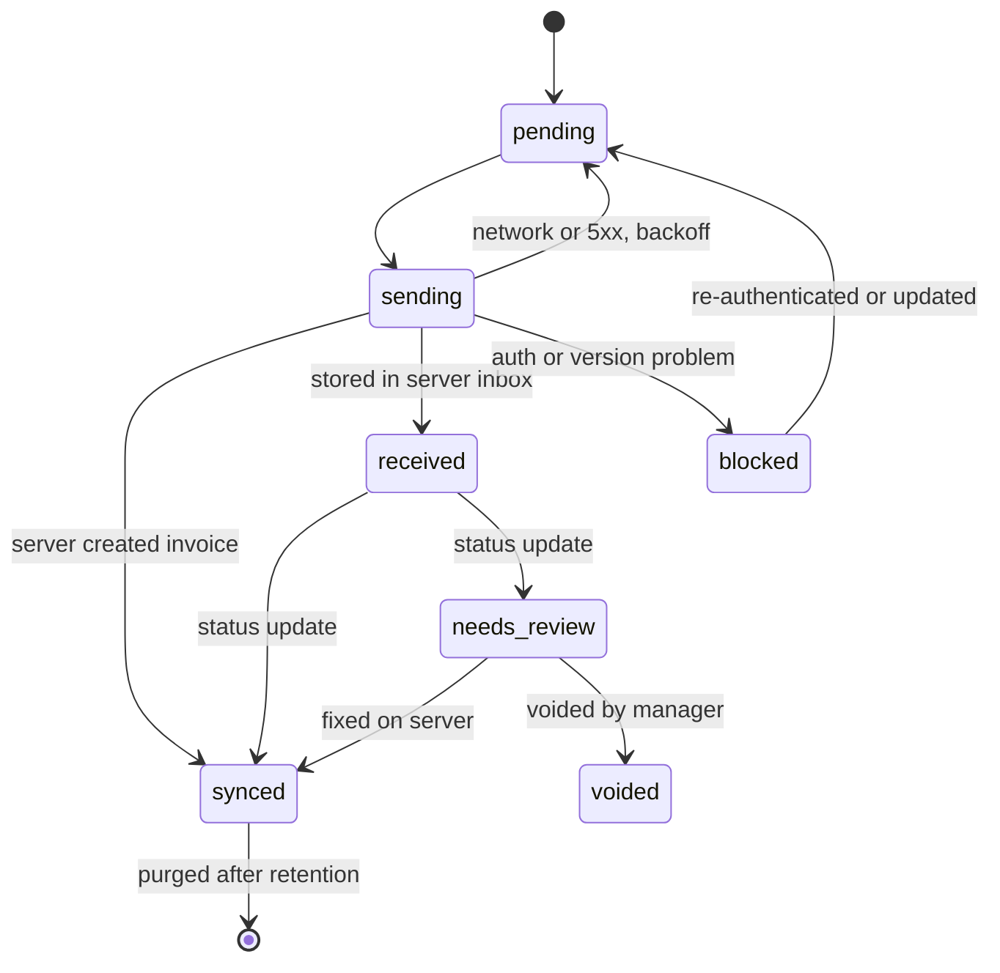

# 03. محرك المزامنة

محرك واحد مشترك بين المنصات الثلاث، يُبنى على نمط **Outbox في الجهاز** و**Inbox في الخادم**. يعالج F-02 وF-03 وF-05 وF-09 وF-12 وF-14 وF-16 وF-18.

## 1. الأوضاع الثلاثة

الأوضاع الثلاثة تختلف في **انتظار الكاشير** ووقت أول إرسال. الإعداد على مستوى POS Settings لكل POS Profile، والافتراضي هو اللحظي لأنه سلوك النظام الحالي.

الوضع اللحظي يرسل مباشرة ولا يكتب في الطابور أولًا، وهذا تعديل مقصود على التصميم الأول. السبب أن الكاشير حاضر، فيرى خطأ مثل نقص المخزون ويصححه قبل الطباعة، بدل أن تذهب الفاتورة للمراجعة. ولا يضيع بيع بهذا، لأن الإيصال لا يُطبع قبل الرد. عند انتهاء المهلة أو انقطاع الشبكة تنتقل الفاتورة إلى الطابور بالمعرف نفسه، فيمنع الخادم أي تكرار. وأوامر البيع ورصيد العميل تبقى مباشرة في كل الأوضاع.

| | لحظية `realtime` | بعد الحفظ والدفع `after_payment` | دورية `periodic` |
|---|---|---|---|
| متى تُرسل | فورًا، والكاشير ينتظر الرد | فورًا في الخلفية | كل N دقيقة في دفعات |
| انتظار الكاشير | حتى المهلة، وافتراضيًا 8 ثوانٍ | لا ينتظر | لا ينتظر |
| رقم الإيصال | رقم الخادم إن وصل في المهلة | الرقم المحلي | الرقم المحلي |
| عند انقطاع الشبكة | يطبع بالرقم المحلي ويبقى في الطابور | يبقى في الطابور | يبقى في الطابور |
| الأنسب | الامتثال، والمؤسسات بشبكة قوية | الاستخدام العام والمحلات المزدحمة | الشبكة الضعيفة والحجم الكبير |



### المشغلات

كل المشغلات تعمل في كل الأوضاع كشبكة أمان، بما فيها الدورية. لذلك لا تبقى فاتورة معلقة لأن حدثًا واحدًا لم يقع.

| المشغل | ملاحظة |
|---|---|
| بعد الحفظ | حسب الوضع |
| مؤقت دوري | القيمة الافتراضية 5 دقائق |
| فتح التطبيق | يعالج فواتير الأمس |
| عودة الاتصال | من `offlineState` الحالي |
| عودة التطبيق للواجهة | Android خصوصًا |
| زر يدوي | موجود الآن |
| قبل إقفال الوردية | إجباري |
| إشعار من الخادم | لاستلام نتائج المعالجة |

## 2. مسار البيع الموحد

يحل `core/checkout` محل الفرعين الحاليين:

1. `buildInvoicePayload()` يبني الحمولة من مصدر واحد مأخوذ من `submitInvoice` في [useInvoice.js:1053](../../POS/src/composables/useInvoice.js#L1053). هذا يعالج F-04.
2. يُضاف وقت البيع بعد تصحيح فرق الساعة، والرقم المحلي، والكاشير، والجهاز، و`client_totals`.
3. `enqueueSale` يكتب معًا: صف outbox، وبيانات الإيصال، وحجز المخزون، وزيادة العداد.
4. تُفرغ السلة بعد نجاح الكتابة فقط.
5. يرسل المحرك حسب الوضع، ثم يطبع.

فشل الكتابة المحلية يوقف البيع برسالة واضحة، لأنه الضمان الوحيد لعدم ضياع الفاتورة.

## 3. حالات الفاتورة في الجهاز



| الحالة | المعنى | تُحذف الحمولة؟ |
|---|---|---|
| `pending` | تنتظر الإرسال | لا |
| `sending` | طلب قيد التنفيذ. عند بدء التطبيق تعود إلى `pending` | لا |
| `received` | الخادم حفظها في الـ Inbox، والمسؤولية انتقلت إليه | لا |
| `blocked` | توقف عام للطابور، مثل انتهاء الجلسة | لا |
| `needs_review` | تحتاج تدخل المدير في الخادم | لا |
| `synced` | تحولت إلى فاتورة | بعد 30 يومًا |
| `voided` | ألغاها المدير مع سبب | بعد 30 يومًا |

الفاتورة التي تحتاج مراجعة لا توقف باقي الطابور، إلا ما يعتمد عليها.

## 4. تصنيف الأخطاء

هذا هو البديل عن مطابقة النصوص الحالية (F-19). الخادم يرسل `error_class` و`error_code` ثابتين وغير مترجمين.

| الفئة | أمثلة | أين تُعالج | السلوك |
|---|---|---|---|
| `transient_network` | انقطاع، مهلة، 502، 503، 504 | الجهاز | Backoff، دون حد للمحاولات |
| `rate_limited` | 429 | الجهاز | احترام `Retry-After` |
| `auth` | 401، 403، جهاز ملغى | الجهاز | إيقاف الطابور كله دون زيادة العدادات |
| `version` | عميل قديم جدًا | الجهاز | إيقاف وطلب تحديث |
| `transient_server` | Deadlock، Lock timeout، `TimestampMismatchError` | الخادم | إعادة تلقائية مع backoff |
| `dependency` | عميل جديد لم يصل، أو فاتورة أصل لمرتجع | الخادم | حالة `Blocked` حتى يصل المرجع |
| `stock` | `NegativeStockError` | الخادم | إعادة تلقائية محدودة ثم مراجعة |
| `business` | فترة مقفلة، صنف معطل، فرق إجمالي، دفع غير صحيح | الخادم | مراجعة مباشرة |
| `contract` | حمولة غير مطابقة للمخطط | الخادم | مراجعة، وتنبيه للمطورين |
| `bug` | أي استثناء غير مصنف | الخادم | مراجعة، وتنبيه للمطورين |

### Backoff في الجهاز

```text
delay = min(30 min, 5s * 3^attempts) * random(0.7, 1.3)
```

## 5. واجهة الخادم

الوحدة `pos_next/api/sync.py`، وكل المسارات مقيدة بجهاز أو جلسة صالحة.

### الإرسال

```text
POST /api/method/pos_next.api.sync.push
```

```json
{
  "device_id": "0190f6c2-...",
  "client_version": "2.0.0",
  "protocol_version": 1,
  "batch_id": "0190f6c3-...",
  "wait_for_result": true,
  "items": [
    {
      "offline_id": "0190f6c4-...",
      "entity": "invoice",
      "entity_version": 1,
      "seq": 1542,
      "local_number": "D07-001542",
      "cashier": "cashier@example.com",
      "pos_profile": "Main Branch",
      "shift": "POSO-00123",
      "created_at_device": "2026-11-06T18:04:11+03:00",
      "clock_offset_ms": -1200,
      "posting_date": "2026-11-06",
      "posting_time": "18:04:12",
      "depends_on": [],
      "payload_hash": "sha256:...",
      "client_totals": { "grand_total": 115.0, "tax": 15.0, "paid": 115.0, "change": 0 },
      "payload": { "doctype": "Sales Invoice", "items": [], "payments": [] }
    }
  ]
}
```

```json
{
  "server_time": "2026-11-06T18:04:13+03:00",
  "results": [
    { "offline_id": "0190f6c4-...", "status": "synced", "invoice": "ACC-SINV-2026-00412" }
  ],
  "next_status_poll_seconds": 30
}
```

| القيمة | معناها للجهاز |
|---|---|
| `synced` | انتهى العمل |
| `received` أو `processing` | الخادم استلمها، وينتظر الجهاز النتيجة |
| `needs_review` | تظهر للمدير، والكاشير يرى تنبيهًا |
| `duplicate` | موجودة، مع اسم الفاتورة، وتُعامل كنجاح |
| `conflict` | نفس `offline_id` بحمولة مختلفة، وتذهب للمراجعة |
| `rejected` | المغلف غير صالح، ويبقى في الجهاز للدعم |

`wait_for_result: true` يعني محاولة المعالجة ضمن الطلب، وهو ما يخدم الوضع اللحظي. بدونه يعود الخادم فور الاستلام.

### الحالة

```text
POST /api/method/pos_next.api.sync.get_status
{ "device_id": "...", "cursor": "...", "offline_ids": ["..."] }
```

يعيد كل تغيير منذ المؤشر. ويدعمه `publish_realtime` لتسريع الوصول، لكن الاستطلاع هو الضامن.

### السحب

```text
POST /api/method/pos_next.api.sync_pull.get_manifest   -> { items: "v91", taxes: "v3", ..., scopes, server_time }
POST /api/method/pos_next.api.sync_pull.pull           -> { rows, deleted, next_cursor, has_more }
```

| الكيان | المؤشر | التكرار | الأولوية |
|---|---|---|---|
| الضرائب، طرق الدفع، الملف الشخصي | manifest | عند البدء وبعد إشعار | حرجة |
| الأصناف والأسعار | `(modified, name)` مع قائمة حذف | 15 دقيقة، وبعد إشعار | عالية |
| العملاء | `(modified, name)` | 15 دقيقة | عالية |
| العروض والكوبونات | manifest | 15 دقيقة | متوسطة |
| قوالب الطباعة والترجمة | manifest | عند البدء | متوسطة |
| المخزون | مسار `get_stock_quantities` الحالي، مع Socket.IO على الويب فقط | حسب الإعداد | عالية |

ترتيب المؤشر المركب يمنع ضياع صفوف لها نفس `modified` عند حدود الصفحات.

كل الكيانات تعمل عند الفتح وعودة الاتصال وكل 15 دقيقة، وأول سحب لكل جهاز ينزل الكتالوج مرة واحدة. وتغيّر نطاق الملف لا يحرك `Item.modified`، لذا يعيد `get_manifest` الحقل `scopes`، واختلافه يبدأ المسح من الصفر. وإعادة تسمية صنف أو عميل تُسجل كحذف للاسم القديم.

## 6. قواعد التعارض

| الحالة | القاعدة |
|---|---|
| تغير سعر أثناء الانقطاع | سعر وقت البيع هو المعتمد، لأن العميل دفعه، ويبقى في الحمولة للتدقيق |
| تغير الضريبة | يقارن الخادم الإجماليات، وأي فرق فوق السماحية يذهب للمراجعة |
| فرق تقريب بسيط | سماحية من الإعداد، وافتراضيًا 0.05 |
| نفاد المخزون | حسب `allow_negative_stock`، وإلا فئة `stock` |
| حذف عميل | مراجعة، مع اقتراح العميل النقدي الافتراضي |
| فاتورة في فترة مقفلة | مراجعة، والمدير يختار تاريخًا مسموحًا مع سبب |
| وردية مقفلة | مراجعة، أو إضافتها كتسوية لوردية مفتوحة حسب السياسة |
| كوبون تجاوز الحد | تقبل الفاتورة لأن العميل استلم الخصم، ويُسجل التجاوز للتدقيق |

## 7. الوقت والترتيب

- **`posting_date`:** تُحسب بتوقيت الموقع، و`set_posting_time = 1` يثبتها عند الترحيل.
- **ساعة الجهاز:** الجهاز يحفظ فرق الساعة من `server_time` في كل رد، ويرسله في كل فاتورة. الخادم يضع علامة على أي تاريخ خارج نافذة الوردية بدل قبوله بصمت.
- **الترتيب:** `seq` تصاعدي لكل جهاز. الخادم يعالج الأقدم أولًا لكل POS Profile، لأن الفواتير المؤرخة بالماضي تؤثر في تقييم المخزون.
- **ملاحظة تشغيلية:** الفواتير المؤرخة بالماضي قد تشغل إعادة ترحيل تقييم المخزون في ERPNext. يجب قياس ذلك في الاختبار على حجم بيانات واقعي.

## 8. المخزون المحلي

```text
available = stock_base.qty - SUM(stock_reservation.stock_qty)
```

- **الحجز:** يُسجل بوحدة المخزون، أي `qty * conversion_factor`.
- **تحديث الخادم:** يكتب `stock_base` فقط، ولا يمس الحجوزات.
- **الإلغاء:** عند `synced` يُحذف الحجز بعد أن يعكس رقم الخادم البيع، أو يُطبق `as_of` للمقارنة.
- **المرتجعات:** تُسجل كحجز سالب.

هذا يعالج F-12 دون إعادة الفشل المذكور في تعليق [offline.worker.js:430](../../POS/src/workers/offline.worker.js#L430)، لأن المخزون المحلي لا يُرسل للخادم.

## 9. الميزات في الأوفلاين

| الميزة | السياسة المقترحة |
|---|---|
| عميل جديد | منفذ ككيان outbox، والفاتورة تعتمد عليه عبر `depends_on`، والاسم المؤقت هو `offline_id` |
| كوبون | منفذ من الكاش، وصلاحيته بتاريخ البيع، والتجاوز يُسجل في `coupon_overrun`، ويُوقف بـ `disable_offline_coupons` |
| رصيد عميل ومحفظة | أونلاين فقط، ومعطلان في الدفع أوفلاين برسالة واضحة |
| بطاقة هدايا | أونلاين فقط، لأنها قيمة مالية |
| بيع آجل | حسب الإعداد، مع حد ائتمان من آخر مزامنة |
| مرتجع لفاتورة في السجل المخزن | منفذ بالإعداد `allow_offline_returns`، والخادم يعيد كل قواعد المرتجع |
| تسديد جزئي | منفذ ككيان outbox لا يتكرر عند إعادة الإرسال |
| فتح وردية | غير منفذ عمدًا، لأن الجهاز لا يعرف وردية مفتوحة في جهاز آخر، فتتعطل كل فواتيرها |
| إقفال وردية | منفذ بالإعداد `allow_offline_shift_close`، والجهاز يرسل المعدود فقط والخادم يحسب الإجماليات |

## 10. قفل المرسل الواحد

| المنصة | الآلية |
|---|---|
| الويب | Web Locks API لتبويب قائد واحد، مع BroadcastChannel لنقل الحالة |
| Electron | `requestSingleInstanceLock` |
| Android | Mutex داخل التطبيق |

القفل يقلل الضجيج فقط. ضمان عدم التكرار يبقى في الخادم عبر `offline_id`.

## 11. إعدادات المزامنة

تضاف إلى POS Settings:

| الحقل | الافتراضي |
|---|---|
| `sync_mode` | `Realtime` |
| `sync_interval_minutes` | 5 |
| `realtime_timeout_seconds` | 8 |
| `sync_batch_size` | 20 |
| `max_offline_hours` | 72 |
| `allow_negative_on_sync` | لا |
| `sync_total_tolerance` | 0.05 |
| `block_shift_close_with_pending` | نعم |

## 12. لوحة الحالة للكاشير

مؤشر واحد في [POSHeader.vue](../../POS/src/components/pos/POSHeader.vue) يوضح: متصل أو غير متصل، وعدد المعلقة، وآخر مزامنة ناجحة. عند الضغط تظهر كل فاتورة بحالتها ونص خطأ مفهوم. تعديل فاتورة في الطابور يبقى متاحًا بالإعداد ما دامت حالتها `pending`، وينشئ نسخة جديدة ويضع `superseded_by` في معاملة واحدة. والحذف الحالي عبر `allow_delete_offline_invoice` يصبح إلغاءً مسببًا يصل إلى الخادم، لأن الفاتورة قد تكون طُبعت للعميل.
