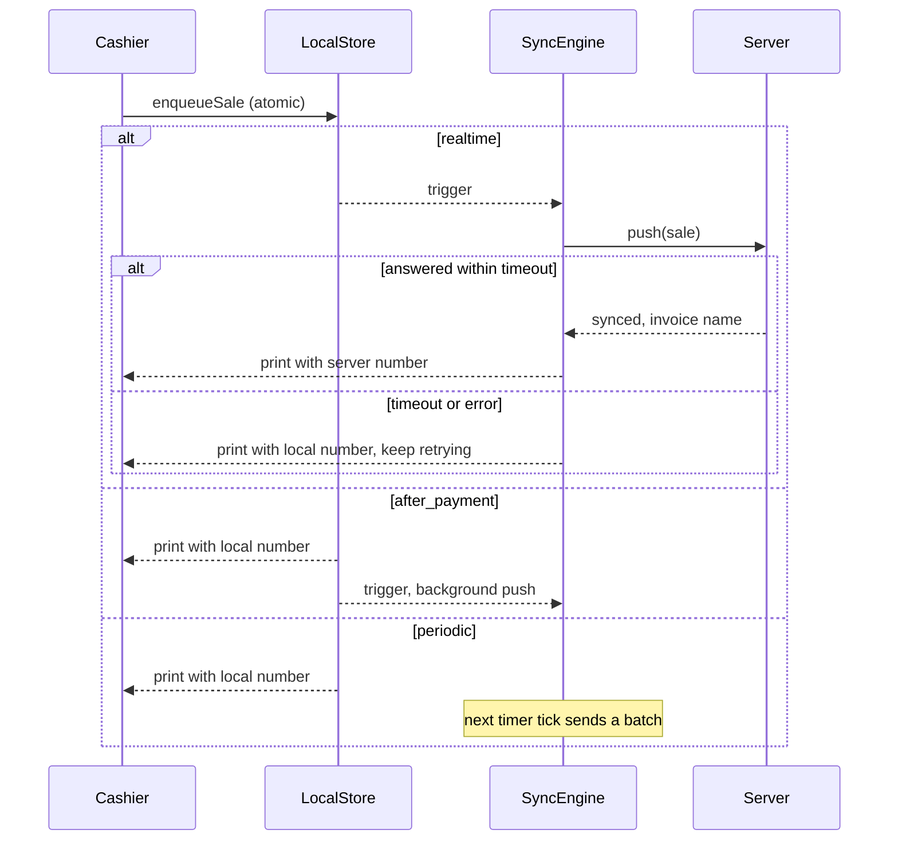
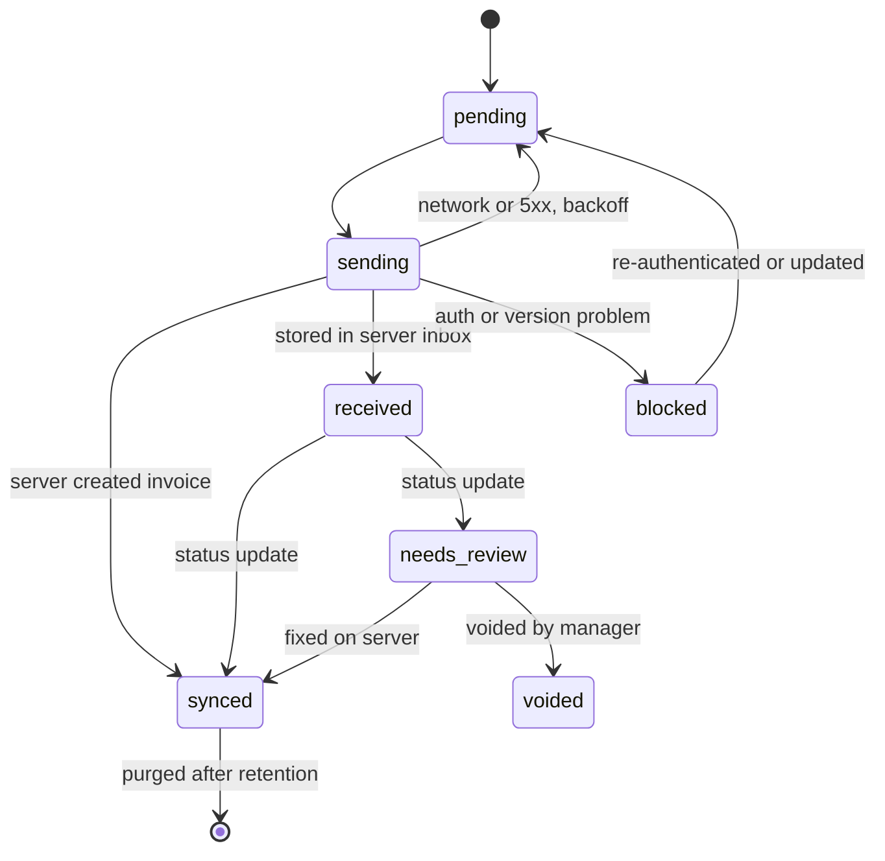

# 03. محرك المزامنة

محرك واحد مشترك بين المنصات الثلاث، يُبنى على نمط **Outbox في الجهاز** و**Inbox في الخادم**. يعالج F-02 وF-03 وF-05 وF-09 وF-12 وF-14 وF-16 وF-18.

## 1. الأوضاع الثلاثة

الأوضاع الثلاثة تختلف في **انتظار الكاشير** ووقت أول إرسال. الإعداد على مستوى POS Settings لكل POS Profile، والافتراضي هو اللحظي لأنه سلوك النظام الحالي.

الوضع اللحظي يرسل مباشرة ولا يكتب في الطابور أولًا، وهذا تعديل مقصود على التصميم الأول. السبب أن الكاشير حاضر، فيرى خطأ مثل نقص المخزون ويصححه قبل الطباعة، بدل أن تذهب الفاتورة للمراجعة. ولا يضيع بيع بهذا، لأن الإيصال لا يُطبع قبل الرد. عند انتهاء المهلة أو انقطاع الشبكة تنتقل الفاتورة إلى الطابور بالمعرف نفسه، فيمنع الخادم أي تكرار. وأوامر البيع ورصيد العميل تبقى مباشرة في كل الأوضاع.

| | لحظية `realtime` | بعد الحفظ والدفع `after_payment` | دورية `periodic` |
|---|---|---|---|
| متى تُرسل | فورًا، والكاشير ينتظر الرد | فورًا في الخلفية | كل N دقيقة في دفعات |
| انتظار الكاشير | حتى المهلة، وافتراضيًا 8 ثوانٍ | لا ينتظر | لا ينتظر |
| رقم الإيصال | رقم الخادم إن وصل في المهلة | الرقم المحلي | الرقم المحلي |
| عند انقطاع الشبكة | يطبع بالرقم المحلي ويبقى في الطابور | يبقى في الطابور | يبقى في الطابور |
| الأنسب | الامتثال، والمؤسسات بشبكة قوية | الاستخدام العام والمحلات المزدحمة | الشبكة الضعيفة والحجم الكبير |



### المشغلات

كل المشغلات تعمل في كل الأوضاع كشبكة أمان، بما فيها الدورية. لذلك لا تبقى فاتورة معلقة لأن حدثًا واحدًا لم يقع.

| المشغل | ملاحظة |
|---|---|
| بعد الحفظ | حسب الوضع |
| مؤقت دوري | القيمة الافتراضية 5 دقائق |
| فتح التطبيق | يعالج فواتير الأمس |
| عودة الاتصال | من `offlineState` الحالي |
| عودة التطبيق للواجهة | Android خصوصًا |
| زر يدوي | موجود الآن |
| قبل إقفال الوردية | إجباري |
| إشعار من الخادم | لاستلام نتائج المعالجة |

## 2. مسار البيع الموحد

يحل `core/checkout` محل الفرعين الحاليين:

1. `buildInvoicePayload()` يبني الحمولة من مصدر واحد مأخوذ من `submitInvoice` في [useInvoice.js:1053](../../POS/src/composables/useInvoice.js#L1053). هذا يعالج F-04.
2. يُضاف وقت البيع بعد تصحيح فرق الساعة، والرقم المحلي، والكاشير، والجهاز، و`client_totals`.
3. `enqueueSale` يكتب معًا: صف outbox، وبيانات الإيصال، وحجز المخزون، وزيادة العداد.
4. تُفرغ السلة بعد نجاح الكتابة فقط.
5. يرسل المحرك حسب الوضع، ثم يطبع.

فشل الكتابة المحلية يوقف البيع برسالة واضحة، لأنه الضمان الوحيد لعدم ضياع الفاتورة.

## 3. حالات الفاتورة في الجهاز



| الحالة | المعنى | تُحذف الحمولة؟ |
|---|---|---|
| `pending` | تنتظر الإرسال | لا |
| `sending` | طلب قيد التنفيذ. عند بدء التطبيق تعود إلى `pending` | لا |
| `received` | الخادم حفظها في الـ Inbox، والمسؤولية انتقلت إليه | لا |
| `blocked` | توقف عام للطابور، مثل انتهاء الجلسة | لا |
| `needs_review` | تحتاج تدخل المدير في الخادم | لا |
| `synced` | تحولت إلى فاتورة | بعد 30 يومًا |
| `voided` | ألغاها المدير مع سبب | بعد 30 يومًا |
| `sale_stands` | طلب الكاشير إلغاءها بعد أن وصلت إلى الخادم، فبقيت، وتظل ظاهرة حتى يؤكد أنه رأى ذلك | تصبح `synced` بعد تأكيده |

طلب الإلغاء ليس حالة، بل حقل `void_reason` على الصف، لأن الجهاز لا يعرف قبل رد الخادم أي حالة هو فيها. انظر القسم 12.

الفاتورة التي تحتاج مراجعة لا توقف باقي الطابور، إلا ما يعتمد عليها.

## 4. تصنيف الأخطاء

هذا هو البديل عن مطابقة النصوص الحالية (F-19). الخادم يرسل `error_class` و`error_code` ثابتين وغير مترجمين.

| الفئة | أمثلة | أين تُعالج | السلوك |
|---|---|---|---|
| `transient_network` | انقطاع، مهلة، 502، 503، 504 | الجهاز | Backoff، دون حد للمحاولات |
| `rate_limited` | 429 | الجهاز | احترام `Retry-After` |
| `auth` | 401، 403، جهاز ملغى | الجهاز | إيقاف الطابور كله دون زيادة العدادات |
| `version` | عميل قديم جدًا | الجهاز | إيقاف وطلب تحديث |
| `transient_server` | Deadlock، Lock timeout، `TimestampMismatchError` | الخادم | إعادة تلقائية مع backoff |
| `dependency` | عميل جديد لم يصل، أو فاتورة أصل لمرتجع | الخادم | حالة `Blocked` حتى يصل المرجع |
| `stock` | `NegativeStockError` | الخادم | إعادة تلقائية محدودة ثم مراجعة |
| `business` | فترة مقفلة، صنف معطل، فرق إجمالي، دفع غير صحيح | الخادم | مراجعة مباشرة |
| `contract` | حمولة غير مطابقة للمخطط | الخادم | مراجعة، وتنبيه للمطورين |
| `bug` | أي استثناء غير مصنف | الخادم | مراجعة، وتنبيه للمطورين |

### Backoff في الجهاز

```text
delay = min(30 min, 5s * 3^attempts) * random(0.7, 1.3)
```

## 5. واجهة الخادم

الوحدة `pos_next/api/sync.py`، وكل المسارات مقيدة بجهاز أو جلسة صالحة.

### الإرسال

```text
POST /api/method/pos_next.api.sync.push
```

```json
{
  "device_id": "0190f6c2-...",
  "client_version": "2.0.0",
  "protocol_version": 1,
  "batch_id": "0190f6c3-...",
  "wait_for_result": true,
  "items": [
    {
      "offline_id": "0190f6c4-...",
      "entity": "invoice",
      "entity_version": 1,
      "seq": 1542,
      "local_number": "D07-001542",
      "cashier": "cashier@example.com",
      "pos_profile": "Main Branch",
      "shift": "POSO-00123",
      "created_at_device": "2026-11-06T18:04:11+03:00",
      "clock_offset_ms": -1200,
      "posting_date": "2026-11-06",
      "posting_time": "18:04:12",
      "depends_on": [],
      "payload_hash": "sha256:...",
      "client_totals": { "grand_total": 115.0, "tax": 15.0, "paid": 115.0, "change": 0 },
      "payload": { "doctype": "Sales Invoice", "items": [], "payments": [] }
    }
  ]
}
```

```json
{
  "server_time": "2026-11-06T18:04:13+03:00",
  "results": [
    { "offline_id": "0190f6c4-...", "status": "synced", "invoice": "ACC-SINV-2026-00412" }
  ],
  "next_status_poll_seconds": 30
}
```

| القيمة | معناها للجهاز |
|---|---|
| `synced` | انتهى العمل |
| `received` أو `processing` | الخادم استلمها، وينتظر الجهاز النتيجة |
| `needs_review` | تظهر للمدير، والكاشير يرى تنبيهًا |
| `duplicate` | موجودة، مع اسم الفاتورة، وتُعامل كنجاح |
| `conflict` | نفس `offline_id` بحمولة مختلفة، وتذهب للمراجعة |
| `rejected` | المغلف غير صالح، ويبقى في الجهاز للدعم |
| `voided` | طلب الإلغاء نُفذ، أو كان السجل ملغى من قبل، ويحذف الجهاز صفه |
| `void_pending` | طلب الإلغاء معلق لأن مهمة تعالج السجل الآن، ويعيد الجهاز السؤال في المزامنة التالية |
| `sale_stands` | السجل في الخادم فعلًا فبقي، ومعه `invoice` و`error_code` الثابت `VoidAfterPosted` |

عنصر فيه `void_reason` طلب إلغاء وليس رفعًا عاديًا، ولا يعود إلا بالقيم الثلاث الأخيرة أو `rejected`. والسبب الفارغ يُرفض، حتى لا يُقرأ العنصر كبيع عادي فيُرحَّل.

`wait_for_result: true` يعني محاولة المعالجة ضمن الطلب، وهو ما يخدم الوضع اللحظي. بدونه يعود الخادم فور الاستلام.

### الحالة

```text
POST /api/method/pos_next.api.sync.get_status
{ "device_id": "...", "cursor": "...", "offline_ids": ["..."] }
```

يعيد كل تغيير منذ المؤشر. ويدعمه `publish_realtime` لتسريع الوصول، لكن الاستطلاع هو الضامن.

### السحب

```text
POST /api/method/pos_next.api.sync_pull.get_manifest   -> { items: "v91", taxes: "v3", ..., scopes, server_time }
POST /api/method/pos_next.api.sync_pull.pull           -> { rows, deleted, next_cursor, has_more }
```

| الكيان | المؤشر | التكرار | الأولوية |
|---|---|---|---|
| الضرائب، طرق الدفع، الملف الشخصي | manifest | عند البدء وبعد إشعار | حرجة |
| الأصناف والأسعار | `(modified, name)` مع قائمة حذف | 15 دقيقة، وبعد إشعار | عالية |
| العملاء | `(modified, name)` | 15 دقيقة | عالية |
| العروض والكوبونات | manifest | 15 دقيقة | متوسطة |
| قوالب الطباعة والترجمة | manifest | عند البدء | متوسطة |
| المخزون | `(modified, name)` على `Bin` لمستودع الملف، بلا قائمة حذف | كل دقيقة على التطبيقين. الويب يعتمد Socket.IO | عالية |

ترتيب المؤشر المركب يمنع ضياع صفوف لها نفس `modified` عند حدود الصفحات.

**المخزون** يخرج عن الجدول في أربعة أمور. السؤال كل دقيقة يطلب `stock_only` من `get_manifest`، لأن السؤال الكامل يعد صفوف الجداول الكبيرة. ونسخته تبقى تتغير ما دامت آخر حركة أحدث من `COMMIT_LAG`، لأن فاتورة تأخر حفظها قد تقع خلف أحدث طابع فلا تحركه. وصفوفه تأتي من `get_stock_quantities`، فيقرأ ما يقرأه الويب، ومعها الحزم التي تحرك أحد مكوناتها. ونطاقه قائمة المستودعات، فلا يبدأ من الصفر إلا إذا تغيرت هي.

كل الكيانات تعمل عند الفتح وعودة الاتصال وكل 15 دقيقة، وأول سحب لكل جهاز ينزل الكتالوج مرة واحدة. وتغيّر نطاق الملف لا يحرك `Item.modified`، لذا يعيد `get_manifest` الحقل `scopes`، واختلافه يبدأ المسح من الصفر. وإعادة تسمية صنف أو عميل تُسجل كحذف للاسم القديم.

## 6. قواعد التعارض

| الحالة | القاعدة |
|---|---|
| تغير سعر أثناء الانقطاع | سعر وقت البيع هو المعتمد، لأن العميل دفعه، ويبقى في الحمولة للتدقيق |
| تغير الضريبة | يقارن الخادم الإجماليات، وأي فرق فوق السماحية يذهب للمراجعة |
| فرق تقريب بسيط | سماحية من الإعداد، وافتراضيًا 0.05 |
| نفاد المخزون | حسب `allow_negative_stock`، وإلا فئة `stock` |
| حذف عميل | مراجعة، مع اقتراح العميل النقدي الافتراضي |
| فاتورة في فترة مقفلة | مراجعة، والمدير يختار تاريخًا مسموحًا مع سبب |
| وردية مقفلة | مراجعة، أو إضافتها كتسوية لوردية مفتوحة حسب السياسة |
| كوبون تجاوز الحد | تقبل الفاتورة لأن العميل استلم الخصم، ويُسجل التجاوز للتدقيق |

## 7. الوقت والترتيب

- **`posting_date`:** تُحسب بتوقيت الموقع، و`set_posting_time = 1` يثبتها عند الترحيل.
- **ساعة الجهاز:** الجهاز يحفظ فرق الساعة من `server_time` في كل رد، ويرسله في كل فاتورة. الخادم يضع علامة على أي تاريخ خارج نافذة الوردية بدل قبوله بصمت.
- **الترتيب:** `seq` تصاعدي لكل جهاز. الخادم يعالج الأقدم أولًا لكل POS Profile، لأن الفواتير المؤرخة بالماضي تؤثر في تقييم المخزون.
- **ملاحظة تشغيلية:** الفواتير المؤرخة بالماضي قد تشغل إعادة ترحيل تقييم المخزون في ERPNext. يجب قياس ذلك في الاختبار على حجم بيانات واقعي.

## 8. المخزون المحلي

```text
available = stock_base.qty - SUM(stock_reservation.stock_qty)
```

- **الحجز:** يُسجل بوحدة المخزون، أي `qty * conversion_factor`.
- **تحديث الخادم:** يكتب `stock_base` فقط، ولا يمس الحجوزات.
- **الإلغاء:** عند `synced` يُحذف الحجز بعد أن يعكس رقم الخادم البيع، أو يُطبق `as_of` للمقارنة.
- **المرتجعات:** تُسجل كحجز سالب.

هذا يعالج F-12 دون إعادة الفشل المذكور في تعليق [offline.worker.js:430](../../POS/src/workers/offline.worker.js#L430)، لأن المخزون المحلي لا يُرسل للخادم.

## 9. الميزات في الأوفلاين

| الميزة | السياسة المقترحة |
|---|---|
| عميل جديد | منفذ ككيان outbox، والفاتورة تعتمد عليه عبر `depends_on`، والاسم المؤقت هو `offline_id` |
| كوبون | منفذ من الكاش، وصلاحيته بتاريخ البيع، والتجاوز يُسجل في `coupon_overrun`، ويُوقف بـ `disable_offline_coupons` |
| رصيد عميل ومحفظة | أونلاين فقط، ومعطلان في الدفع أوفلاين برسالة واضحة |
| بطاقة هدايا | أونلاين فقط، لأنها قيمة مالية |
| بيع آجل | حسب الإعداد، مع حد ائتمان من آخر مزامنة |
| مرتجع لفاتورة في السجل المخزن | منفذ بالإعداد `allow_offline_returns`، والخادم يعيد كل قواعد المرتجع |
| تسديد جزئي | منفذ ككيان outbox لا يتكرر عند إعادة الإرسال |
| فتح وردية | منفذ بالإعداد `allow_offline_shift_open`، ككيان outbox باسم مؤقت. الجهاز لا يعرف وردية مفتوحة في جهاز آخر، لذا يذهب التعارض إلى المراجعة، وتبقى فواتيرها `Blocked` |
| إقفال وردية | منفذ بالإعداد `allow_offline_shift_close`، والجهاز يرسل المعدود فقط والخادم يحسب الإجماليات |

### فتح الوردية أوفلاين

الإعداد `allow_offline_shift_open` معطل افتراضيًا. وعند تعطيله، أو عند غياب ملف محفوظ لهذا الكاشير، يقول الحوار السبب ولا يفتح شيئًا.

**ما يعرفه الجهاز.** لا تُحمّل الإعدادات قبل فتح الوردية، لذا يقرأ الحوار نسخة `pos_next_settings_<profile>` التي حفظها آخر تحميل لذلك الملف. نسخة أقدم من الحقل تُعد رفضًا، وكذلك `custom_disable_offline_mode`. وثيقتا POS Profile وCompany تُحفظان في `shift_profiles_<user>` مع كل وردية يبلغ عنها الخادم، لكل كاشير على حدة، وتبقيان بعد الإقفال لأن الفتحة نفسها تُمسح عنده. فلا بد إذن من وردية واحدة على الأقل مع اتصال، بعد التحديث، على هذا الجهاز ولهذا الكاشير. طرق الدفع من الكاش دون المحافظ، وملف بلا طرق دفع محفوظة لا يُعرض لأن الخادم سيرفضه.

**السجل.** كيان `shift_open`، و`offline_id` هو اسم الوردية إلى أن يعطيها الخادم اسمها، كما يحدث مع العميل الجديد. الوردية تُكتب في فتحة الوردية الحالية نفسها دون جدول جديد، فلا تُفتح وردية ثانية على الجهاز. ووردية كاشير آخر في الفتحة تمنع الفتح برسالة واضحة، لأن الوردية تبقى لصاحبها بعد الخروج. وتجاوز حد الأوفلاين يمنع الفتح كما يمنع البيع.

**الاعتماد.** الفاتورة والتسديد والإقفال تحمل الاسم المحلي، ويُضاف إلى `depends_on` في الجهاز والخادم معًا. وردية جديدة بعد إقفال أوفلاين تعتمد على ذلك الإقفال، لأن الخادم يبقي الوردية السابقة مفتوحة حتى ينتهي.

**عودة الاتصال قبل وصول الوردية.** الخادم لا يقبل عملًا لوردية لا يعرفها، فما دام الاسم محليًا تمر المبيعات والمرتجعات والتسديدات والإقفال بالطابور رغم الاتصال، وهذا هو `mustQueue` في `useOfflineStatus`. والمدفوعات التي تحتاج الخادم، كرصيد العميل، تبقى معطلة. جواب الخادم بأنه لا وردية، أو بوردية أخرى، لا يُنهي الوردية المحلية ما دام سجلها لم ينتهِ.

**وصول الوردية.** `sync_entities.open_shift` يعمل بجلسة الكاشير، ويستدعي `insert_opening_shift` الذي يستدعيه المسار المباشر أيضًا، فيُنشأ POS Opening Entry عند الاعتماد بالكود نفسه في ملفات POS Invoice. الوقت والمبالغ من الجهاز. الحقل `offline_id` فريد، و`bench migrate` ينشئ فهرسه من تعريف الـ DocType، فلا حاجة إلى patch. `add_sync_pull_indexes` موجود لأن فهرسه مركب، والـ DocType لا يعرّف ذلك.

السجلات التي وصلت قبل الوردية تُخزن بلا `shift`، فيضعها الخادم على الوردية في معاملة إنشائها، لأن الإقفال و`has_pending_close` يبحثان بهذا الحقل. وما يصل بعدها يأخذ الاسم الحقيقي عند التخزين. والجهاز يأخذ الاسم الحقيقي من الحدث `offlineEntitySynced`، ويبقى `offline_id` على الوردية، فيجد الإقفال المبيعات التي تحمل الاسم القديم.

**الرفض.** يذهب السجل إلى المراجعة بكود ثابت، مع نص في `offline_invoice_sync.js`، وتبقى فواتيره `Blocked`:

| الكود | السبب | ما يفعله المدير |
|---|---|---|
| `ShiftConflictError` | للكاشير وردية مفتوحة، أو الملف مفتوح لوردية أو قيد ERPNext آخر | يقفلها ثم Reprocess، أو Link to Open Shift |
| `ShiftOutdatedError` | ملف POS Invoice ووردية من يوم سابق، لأن ERPNext يرفض فواتيرها ويبقى القيد مانعًا للملف | يفتح وردية اليوم ثم Link to Open Shift |
| `OfflineShiftNotAllowedError` | الإعداد عُطل بعد أن حفظ الجهاز نسخته، أو الطلب تجاوز فحص الجهاز | يفعّله ثم Reprocess، أو Link to Open Shift |
| `LinkedShiftCloseError` | إقفال وردية رُبطت بوردية أخرى | تبقى تلك الوردية مفتوحة لصاحبها. عند إقفالها يضيف هذا العد إلى مبالغها، ثم يلغي السجل |
| `NotShiftHolderError` | إقفال من كاشير لا يملك الوردية التي يسميها، كجهاز أخذ اسم وردية زميل بعد الربط | مثل السابق |

**Link to Open Shift** تحت Fix Record، ثم Reprocess. تُقبل وردية مفتوحة على الملف نفسه لا تنتظر إقفالًا. فواتير POS Invoice تنتقل إلى صاحب تلك الوردية، للسبب نفسه في `_move_to_shift`. الجهاز لا يستطيع إرسال هذا الربط بنفسه، و`validate_envelope` يرفضه. وإقفال الوردية المرتبطة لا يُقفل الوردية التي رُبطت بها، لأن عد الجهاز يخص درجه فقط وقد تكون تلك الوردية مستخدمة. لذلك لا يأخذ هذا الإقفال حقل `shift` أصلًا، و`has_pending_close` يتجاهل أي إقفال رُفض بأحد الكودين أعلاه، فلا تختفي الوردية عن صاحبها.

إقفال وردية نيابة عن صاحبها مسار حقيقي، لكنه مباشر فقط: نموذج Desk و`submit_closing_shift` يمران على `assert_shift_access` ولا يقارنان صاحب الوردية. أما الطابور فلا مسار له فيه، لأن نقطة البيع لا تعرض للكاشير إلا ورديته، وتسجل الإقفال باسم مستخدم الجلسة.

إلغاء السجل يرسل فواتيره إلى المراجعة بفئة `dependency`، ويُنهي الوردية على الجهاز.

**حدود معروفة.** ساعة الجهاز معتمدة دون فحص. وسجل يُخزن في اللحظة نفسها التي تُنشأ فيها الوردية قد يبقى بلا `shift`، وحده الإقفال عبر `depends_on` يبقى مضمونًا عندها.

**ما يجب فحصه على موقع حقيقي**، بكاشير منخفض الصلاحيات، لأن الاختبارات هنا مقلدة:

1. `SHOW INDEX FROM \`tabPOS Opening Shift\`` يعرض فهرسًا فريدًا `offline_id` بعد `bench migrate`، والورديات القديمة قيمتها NULL.
2. دفع `shift_open` وفاتورة ثم معالجتها في عامل RQ: مالك الوردية و`user` هما الكاشير، و`period_start_date` وقت الجهاز، والفاتورة على الاسم الحقيقي، و`shift` مملوء على سجلها.
3. إعادة الدفع نفسه، ثم تشغيل عاملين معًا: وردية واحدة.
4. ملف POS Invoice: يُنشأ POS Opening Entry بصلاحيات الكاشير، وتُرحّل الفاتورة، ثم يعمل الإقفال.
5. فلتر `depends_on` بـ `like` مع `shift` `is not set` على MariaDB.
6. كاشير له وردية مفتوحة: `ShiftConflictError`، ثم Link to Open Shift من Desk، ووصول الفاتورة إلى تلك الوردية.

## 10. قفل المرسل الواحد

| المنصة | الآلية |
|---|---|
| الويب | Web Locks API لتبويب قائد واحد، مع BroadcastChannel لنقل الحالة |
| Electron | `requestSingleInstanceLock` |
| Android | Mutex داخل التطبيق |

القفل يقلل الضجيج فقط. ضمان عدم التكرار يبقى في الخادم عبر `offline_id`.

## 11. إعدادات المزامنة

تضاف إلى POS Settings:

| الحقل | الافتراضي |
|---|---|
| `sync_mode` | `Realtime` |
| `sync_interval_minutes` | 5 |
| `realtime_timeout_seconds` | 8 |
| `sync_batch_size` | 20 |
| `max_offline_hours` | 72 |
| `allow_negative_on_sync` | لا |
| `sync_total_tolerance` | 0.05 |
| `block_shift_close_with_pending` | نعم |

## 12. لوحة الحالة للكاشير

مؤشر واحد في [POSHeader.vue](../../POS/src/components/pos/POSHeader.vue) يعرض حالة الاتصال، وما ينتظر الإرسال، وما يحتاج مراجعة، وآخر مزامنة.

- **ينتظر الإرسال** يعدّ فقط ما لم يصل إلى الخادم بعد. سجل وصل ويُعالج هناك لم يعد في خطر، فلا يُحسب.
- **آخر مزامنة** هي آخر مرة وصل فيها سجل إلى الخادم من الطابور.
- **الضغط** يفتح قائمة الانتظار دائمًا، حتى وهي فارغة.

القائمة نفسها تحمل كل السجلات: فواتير وعملاء ودفعات وإقفال ورديات، وتعرض لكل نوع ما يخصه. المبلغ والأصناف والطباعة للفواتير فقط.

تعديل فاتورة في الطابور يبقى متاحًا بالإعداد ما دامت حالتها `pending`، وينشئ نسخة جديدة ويضع `superseded_by` في معاملة واحدة.

### الإلغاء المسبب

لا يوجد حذف محلي من الطابور. الإيصال قد يكون عند العميل، وقد يكون `push` وصل إلى الخادم وضاع رده فقط، فلو حذف الجهاز السجل لاكتملت الفاتورة وهو يظن أنها اختفت. لذلك يصبح الزر بإعداد `allow_delete_offline_invoice` طلب إلغاء بسبب إلزامي:

- **يبقى السجل في الطابور** بحالة "ينتظر الإلغاء" ومعه السبب، حتى يجيب الخادم.
- **لا يُحسب لشيء:** لا يحجز مخزونًا، ولا يُعدّل، ولا يُطبع، ولا يُرتجع، ولا يدخل في عد الدفعات والكوبونات. يُسجل الطلب وفك الحجز في معاملة واحدة في SQLite، وعلى الويب يُحسب الحجز من الصفوف فلا يبقى له أثر.
- **يبقى في قائمة الوردية،** فلا يكتمل إقفالها قبل معرفة نهايته، لأنه قد يتبين أنه بيع قائم.
- **التبعيات:** يُرفض الطلب إذا كانت سجلات أخرى تعتمد على السجل.
- **في الأوفلاين** ينتظر الطلب، وهذه فائدته. ويصل في أول `push` بعد الاتصال، ولا ينتظر مهلة إعادة المحاولة.
- **إجابة الخادم:** الوحيدة التي تُنهي الانتظار هي `voided` أو `sale_stands`. أي إجابة عادية عن السجل، حتى لو كانت في الطريق لحظة الطلب، لا تلغيه.

| إجابة الخادم | ما يفعله الجهاز |
|---|---|
| `voided` | يحذف الصف وإيصاله، ويبلّغ التطبيق حتى يتوقف عن استخدام ما يمثله السجل |
| `void_pending` | يبقى الصف، ويعيد السؤال في المزامنة التالية |
| `sale_stands` | يبقى الصف في القائمة بحالة "لم يُلغ" مع رقم الفاتورة، ويظهر تنبيه. لا يخرج حتى يضغط الكاشير "فهمت"، ثم يعامل كسجل `synced` |
| `rejected` | يبقى الصف ويتراجع، وبعد ثلاث محاولات يظهر للكاشير أنه يحتاج تدخلًا، مع استمرار المحاولة |

ولأن الكاشير قد يكون رد المال للعميل، يمنع الصف بحالة "لم يُلغ" إقفال الوردية أونلاين حتى يراه. والبيع القائم يبقى قابلًا للإرجاع، لأن هذا هو الطريق لعكسه الآن.

| الكيان | الإلغاء |
|---|---|
| فاتورة، ومرتجع | منفذ |
| عميل | منفذ. يخرج العميل المحلي من الاستخدام لحظة الطلب، حتى لا تعتمد عليه فاتورة جديدة |
| دفعة | منفذ |
| إقفال وردية | **مستثنى عمدًا،** في الجهاز والخادم |

إقفال الوردية مستثنى لأن الإلغاء خطأ في حقه. عند الإقفال تخرج الوردية من الجهاز، ويكون الكاشير قد عدّ المال وسلمه، والعدّ موجود في هذا الصف فقط. إلغاؤه يعيد الوردية مفتوحة في الخادم ويرفع علامة الإقفال عن الجهاز، فيعود الكاشير إلى وردية ظن أنها أُغلقت، وقد تكون له وردية أحدث، ويضيع ما عدّه. وليس له إيصال عند عميل، وهو سبب هذه الميزة أصلًا. ولا يمكن الرد عليه بأنه قائم من مستند، لأن `find_shift_close` لا يبحث عن مستند عمدًا. من يريد إلغاءه فالمدير من شاشة السجل.

ما يفعله الخادم في [04](04-failed-invoices-log.md#10-الإلغاء-من-الجهاز).
