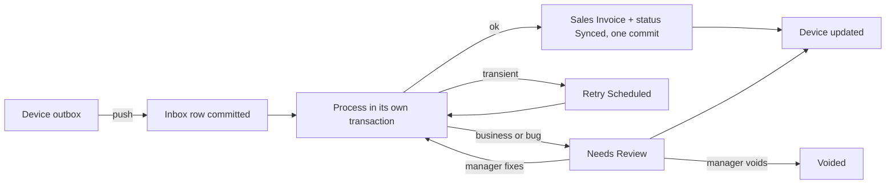

# 04. سجل الفواتير الفاشلة ومعالجتها في الخادم

المطلوب: أي فاتورة تفشل تصل إلى سجلها في الخادم، وتُعالج أخطاؤها وتُصحح هناك. يعالج هذا الملف F-01 وF-13 وF-15.

## 1. الفكرة

**كل فاتورة تدخل الـ Inbox قبل أن تُعالج.** لا يوجد مسار خاص بالفاشلة، بل كل فاتورة تُحفظ بحمولتها الأصلية في معاملة مستقلة، ثم تبدأ المعالجة. إذا فشلت فهي موجودة أصلًا في السجل، مع الخطأ والحمولة.

هذا يصلح السبب الجذري في F-01، لأن تسجيل الفشل لا يعود داخل المعاملة التي تُعاد للخلف.



## 2. تطوير `Offline Invoice Sync`

القرار: **توسيع DocType الموجود** بدل إنشاء سجل موازٍ. القيد الفريد والتقرير والبيانات التاريخية موجودة فيه، وسأبقي الاسم لتجنب ترحيل غير ضروري، بينما يكون العنوان الظاهر "سجل مزامنة الفواتير".

### الحقول الجديدة

| الحقل | النوع | الغرض |
|---|---|---|
| `status` | Select | القيم الموضحة في القسم 3 |
| `entity` | Select | invoice، customer، payment، shift_close |
| `device_id` | Data | من أين جاءت، ويصبح Link إلى POS Device في المرحلة 3 |
| `cashier` | Link إلى User | من باع فعلًا |
| `uploaded_by` | Link إلى User | من رفعها، وقد يكون زميلًا على الجهاز نفسه |
| `shift` | Link إلى POS Opening Shift | الوردية |
| `local_number` | Data، مفهرس | الرقم المطبوع، وللبحث عند الشكوى |
| `client_created_at` | Datetime | وقت البيع في الجهاز |
| `received_at`، `processed_at` | Datetime | قياس التأخير |
| `seq` | Int | ترتيب الجهاز |
| `client_version`، `protocol_version` | Data، Int | توافق الحمولة |
| `payload_hash` | Data | كشف التعارض |
| `original_payload` | Long Text، للقراءة فقط | الحمولة كما وصلت، ولا تتغير أبدًا |
| `payload` | Long Text | النسخة القابلة للتصحيح |
| `client_grand_total`، `client_paid_amount` | Currency | المقارنة مع الخادم |
| `server_grand_total` | Currency | بعد الحساب |
| `error_class`، `error_code` | Select، Data | التصنيف الثابت |
| `error_message` | Small Text | رسالة مفهومة |
| `traceback` | Code | للمطورين |
| `error_fingerprint` | Data، مفهرس | تجميع الأخطاء المتشابهة |
| `attempts`، `next_retry_at` | Int، Datetime | إعادة المحاولة |
| `depends_on` | Long Text | المراجع المنتظرة، وتشمل قائمة فواتير الوردية عند إقفالها |
| `resolution`، `resolution_note` | Select، Small Text | ماذا فُعل ولماذا |
| `resolved_by`، `resolved_at` | Link، Datetime | التدقيق |
| `attempt_log` | Table | سجل كل محاولة |

الجدول الفرعي `Offline Invoice Sync Attempt` يحفظ: الوقت، ومن نفذ، والفئة، والرسالة، والمدة. ويُفعّل `track_changes` لتوثيق أي تعديل.

### حقل في الفاتورة

يضاف Custom Field باسم `offline_id` إلى Sales Invoice وPOS Invoice بفهرس فريد، ويضاف `local_number` مع الرقم المحلي في المرحلة 2. هذا خط الدفاع الأخير: حتى لو فُقد سجل الـ Inbox يرفض القيد في قاعدة البيانات أي تكرار.

تأكد ذلك على `acc`: الفواتير القديمة بقيمة NULL، فلا تتعارض مع القيد الفريد.

## 3. الحالات

| الحالة | المعنى | التالي |
|---|---|---|
| `Received` | حُفظت ولم تبدأ | `Processing` |
| `Processing` | قيد التنفيذ | `Synced` أو غيرها |
| `Retry Scheduled` | خطأ مؤقت، بموعد في `next_retry_at` | `Processing` |
| `Blocked` | تنتظر مرجعًا في `depends_on` | `Received` |
| `Needs Review` | تنتظر قرار المدير | `Received` أو `Voided` أو `Resolved` |
| `Synced` | أُنشئت الفاتورة | نهائية |
| `Resolved` | حُلت يدويًا وربطت بفاتورة قائمة | نهائية |
| `Voided` | ألغيت مع سبب، من المدير أو من طلب جهاز | نهائية |

ترحيل البيانات: `Pending` القديمة تتحول إلى `Needs Review` بملاحظة أنها بلا حمولة، و`Synced` تبقى، و`Failed` تتحول إلى `Needs Review`.

## 4. حدود المعاملات

هذا أهم جزء في التنفيذ.

```python
# pos_next/services/sync_inbox.py (sketch)

def ingest(envelope, device):
    """Transaction 1: nothing here may depend on invoice validity."""
    name = upsert_inbox(envelope, device)   # unique offline_id, conflict check by hash
    frappe.db.commit()  # nosemgrep: durability boundary
    return name

def process(name):
    row = lock_row(name)
    if row.status in FINAL_STATES:
        return row

    # Crash safety: the invoice may exist while the status update was lost
    existing = find_invoice_by_offline_id(row.offline_id)
    if existing:
        return mark_synced(row, existing)

    mark_processing(row)
    frappe.db.commit()  # nosemgrep

    try:
        frappe.set_user(row.cashier)
        invoice = invoice_processor.create_and_submit(row.payload, context_from(row))
        mark_synced(row, invoice)
        frappe.db.commit()  # nosemgrep: invoice and status commit together
    except Exception as exc:
        frappe.db.rollback()
        record_failure(name, classify(exc), exc)
        frappe.db.commit()  # nosemgrep: failure survives, unlike the current finally block
    finally:
        frappe.set_user(previous_user)  # captured before set_user(row.cashier)
```

القواعد:

- **منطق واحد:** `invoice_processor` يُستخرج من `update_invoice` و`submit_invoice`، وهما يبقيان غلافًا للتوافق مع الأجهزة القديمة.
- **لا ابتلاع للأخطاء:** شطب الرصيد والمحفظة والكوبون داخل معاملة الفاتورة. أي فشل يعيد الفاتورة كلها، فتظهر في السجل بدل نجاح ناقص (F-13).
- **المعالجة الخلفية:** `frappe.enqueue` بقائمة `short` و`job_id` لكل سجل، مع عامل يأخذ الأقدم أولًا لكل POS Profile.
- **مهمة كنس كل دقيقة:** `pos_next.tasks.sync.sweep_inbox` تعيد سجلات `Processing` الأقدم من 10 دقائق، وتنفذ `Retry Scheduled` المستحقة، وتفك `Blocked`.
- **الإعادة التلقائية:** `transient_server` حتى 5 مرات بفواصل متزايدة. `stock` كل 15 دقيقة حتى 4 مرات، لأن استلام بضاعة قد يحل المشكلة، ثم مراجعة.

## 5. شاشة المعالجة

في Desk صفحة "مركز المزامنة" (`pos_sync_center`) مبنية فوق DocType `Offline Invoice Sync`. تتحدث عن "سجلات" لا "فواتير"، لأنها تحمل الفواتير والعملاء والدفعات وإقفال الورديات:

- **فلاتر سريعة:** تحتاج مراجعة، الأقدم، حسب الفرع، الجهاز، الكاشير، الفئة.
- **تجميع حسب الخطأ:** باستخدام `error_fingerprint`. عشرون فاتورة بسبب صنف معطل تُعرض كمشكلة واحدة.
- **بطاقة الفاتورة:** الحمولة كجدول مقروء، ومقارنة إجماليات العميل والخادم، والخطأ بلغة مفهومة، وسجل المحاولات.

### أدوات التصحيح

في نموذج السجل مجموعتان: **تصحيح السجل** و**إغلاق دون معالجة**، وسطر **ما يجب فعله** يشرح الخطوة التالية حسب فئة الخطأ. الأدوات تتغير حسب نوع السجل:

| النوع | الأدوات |
|---|---|
| فاتورة | أدوات الجدول أدناه، وقبول فرق الإجمالي، وإبقاء البيع دون الكوبون إذا كان عليها كوبون |
| عميل | تغيير مجموعة العميل، وتغيير المنطقة |
| دفعة | أدوات الدفع الأربع، منها تغيير المبلغ |
| إقفال وردية | إقفال دون الفواتير غير المكتملة |

| الخطأ الشائع | أداة التصحيح |
|---|---|
| مخزون غير كاف | اختيار مستودع آخر، أو إعادة المحاولة بعد الاستلام، أو رابط لإنشاء Stock Entry |
| فترة محاسبية مقفلة | تغيير `posting_date` إلى تاريخ مسموح مع سبب |
| صنف معطل أو محذوف | استبدال الصنف، أو تفعيله ثم إعادة المعالجة |
| عميل غير موجود | ربطه بعميل قائم |
| طريقة دفع بلا حساب | إصلاح الإعداد ثم إعادة المعالجة، أو تحويلها لطريقة أخرى |
| فرق الإجمالي | اعتماد مبلغ العميل بخصم تسوية، أو تسجيل مبلغ مستحق بسبب |
| Batch أو Serial غير صالح | اختيار بديل صالح |
| وردية مقفلة | الربط بوردية مفتوحة كتسوية |
| فاتورة أنشئت يدويًا | ربطها وتحويل الحالة إلى `Resolved` |
| `VoidAfterPosted` | لا تعديل على السجل. انظر القسم 10 |

### الإجراءات

| الإجراء | الصلاحية | ملاحظة |
|---|---|---|
| إعادة المعالجة | Nexus POS Manager | يعيدها إلى `Received` بعد التصحيح |
| إعادة جماعية | Nexus POS Manager | لكل فواتير البصمة نفسها، بعد إصلاح السبب |
| ربط بفاتورة قائمة | Nexus POS Manager | `Resolved` مع ملاحظة إلزامية |
| إلغاء | Nexus POS Manager | `Voided` مع سبب إلزامي، ويظهر للتدقيق. طلب الجهاز له مسار مستقل، انظر القسم 10 |
| تعديل المبالغ | Accounts Manager | يتطلب سببًا، ويُسجل الفرق |

القيود:

- `original_payload` لا يتغير أبدًا، وكل تصحيح يظهر كفرق عنه. لا يُفرغه إلا انتهاء مدة الاحتفاظ، انظر القسم 8.
- التعديل مسموح فقط في `Needs Review`.
- الكاشير لا يملك صلاحية الكتابة. الصلاحيات الحالية تعطي `POSNext Cashier` و`Sales User` إنشاء وكتابة، ويجب تقليصها لأن السجل سيحتوي بيانات مالية.
- الواجهة البرمجية للجهاز تكتب عبر `ignore_permissions` داخل دالة موثقة بالجهاز فقط.

## 6. التنبيهات والمراقبة

| الحدث | من يُبلّغ | القناة |
|---|---|---|
| فاتورة جديدة تحتاج مراجعة | مدير الفرع | إشعار Frappe |
| مراجعة أقدم من 4 ساعات | مدير الفرع | إشعار Frappe كل ساعة |
| سجل جديد يحتاج مراجعة منذ آخر بريد | مستلمو `sync_alert_recipients` للملف | بريد، في فحص كل ساعة |
| فئة `bug` أو `contract` | الدعم الفني | Error Log وبريد |
| جهاز لم يتصل منذ 24 ساعة ولديه فواتير | مدير الفرع | إشعار |
| ارتفاع مفاجئ لنفس البصمة | الدعم الفني | بريد |

**بريد المراجعة:** لا يُرسل شيء ما دام `sync_alert_recipients` فارغًا في `POS Settings`، وهذا هو الافتراضي. مع وجود مستلمين، ترسل المهمة الساعية ملخصًا لكل ملف نقطة بيع: العدد حسب مجموعة الخطأ، وأقدم سجل، ورابط مركز المزامنة.

- **لا تكرار:** يُرسل البريد فقط إذا دخل سجل إلى `Needs Review` بعد آخر إرسال. يُقارن ذلك بـ`processed_at`، ويُحفظ في `sync_alert_last_sent_at` أحدث وقت شمله البريد لا وقت الساعة، حتى لا يضيع سجل فشل أثناء التشغيل.
- **لا انتظار 4 ساعات:** البريد يشمل كل ما ينتظر المراجعة، فلا يتأخر عن أول فحص بعد الفشل.
- **فشل الإرسال:** يُسجل في Error Log ولا يوقف المهمة ولا يمس الملفات الأخرى. لا يتغير وقت آخر إرسال، فتُعاد المحاولة في الساعة التالية.
- **الوسيلة:** `frappe.sendmail` عبر طابور البريد، فالإرسال الفعلي يتطلب حساب بريد صادر افتراضيًا.

يُحدّث [التقرير الصحي](../../pos_next/pos_next/report/offline_sync_and_system_health_report/offline_sync_and_system_health_report.py) ليقرأ `error_message` مباشرة بدل بحثه الحالي في Error Log، ويضيف:

- عدد الفواتير حسب الحالة والجهاز.
- متوسط تأخير المزامنة والنسبة المئوية 95.
- معدل النجاح من أول محاولة.
- الفواتير المفتوحة حسب العمر.

## 7. الرجوع إلى الجهاز

بعد أي تغيير في الخادم:

1. `publish_realtime("pos_sync_status", ..., after_commit=True)` لغرفة الجهاز.
2. الجهاز يحدث صف outbox، واسم الفاتورة، وسجل الفواتير.
3. يُزال الحجز من المخزون المحلي عند `synced` أو `voided`.
4. إذا غاب الإشعار، يصل التحديث عبر `get_status`.

## 8. الاحتفاظ بالبيانات

**لا يُحذف شيء حتى يحدد أحد المدة.** `sync_payload_retention_days` في `POS Settings` لكل ملف نقطة بيع، والافتراضي 0 يعني الاحتفاظ دائمًا. المدة تحتاج مراجعة مع متطلبات الضريبة والمحاسبة قبل ضبطها، لأن التفريغ لا يمكن الرجوع عنه.

| البيان | ما يحدث بعد المدة |
|---|---|
| `payload` و`original_payload` في `Synced` و`Resolved` و`Voided` | تُفرغ |
| الصف، و`payload_hash`، والمبالغ، و`depends_on`، وسجل المحاولات | تبقى للتدقيق |
| كل حالة أخرى، ومنها `Needs Review` و`Blocked` و`Received` و`Processing` | لا تُمس أبدًا |
| سجل بلا ملف نقطة بيع | لا مدة له، فيبقى |

القواعد:

- **بداية المدة:** من آخر تعديل على السجل (`modified`)، أي من انتهائه لا من البيع، فسجل بقي أسابيع في المراجعة يأخذ مدته كاملة.
- **الدفعات:** المهمة `clear_old_payloads` في `daily_long` تعمل على 500 سجل في كل دفعة، وتثبت بعد كل دفعة، فلا تحتجز قفلًا طويلًا. وإذا انقطعت تكمل في اليوم التالي.
- **الأثر:** كل سجل يُفرغ يحصل على سطر `payload cleared` في سجل المحاولات، ولا يتغير `modified`.
- **السجل المُفرغ:** `reprocess` و`apply_fix` يرفضانه برسالة واضحة، حتى لو أُعيدت حالته يدويًا إلى `Needs Review`. يُعرف بوجود `payload_hash` مع غياب `original_payload`، وهو ما لا يحدث لغيره.
- **إعادة الإرسال من الجهاز:** لا تعيد الحمولة. البصمة المحفوظة تجيب: الحمولة نفسها مقبولة دون كتابة، والمختلفة `conflict`.

الصلاحية: `POSNext Cashier` يملك الكتابة على `POS Settings`، وشاشة الإعدادات في نقطة البيع تعيد كل ما تقرؤه. لذلك لا تصل هذه الحقول إلى نقطة البيع، ويرفض الحفظ تغييرها من غير `Nexus POS Manager` أو `System Manager`.

## 9. إقفال الوردية

- **أونلاين:** المسودة تحسب من الخادم، والإقفال يُمنع إذا كان في الجهاز فواتير `pending`، أو في الخادم فواتير غير نهائية لهذه الوردية.
- **قائمة مطابقة:** يرسل الجهاز `offline_ids` لكل فواتير الوردية كتبعيات، فأي فاتورة لم تصل توقف الإقفال، وتُذكر باسمها في المراجعة بعد 30 دقيقة.
- **جدول المطابقة:** في نموذج سجل إقفال الوردية جدول من `get_shift_reconciliation`: كل بند في القائمة بحالته وفاتورته، وما يملكه الخادم لهذه الوردية خارج القائمة. يقرأ `depends_on` بالجملة، فيبقى عمليًا مع أكثر من ألف معرّف، ويعمل بعد تفريغ الحمولة. ما يظهر خارج القائمة ليس خطأ بالضرورة، لأن القائمة تحمل ما كان في طابور الجهاز، أما البيع أونلاين فلا يمر به.
- **أوفلاين:** عند تفعيل الميزة، يُسجل الإقفال ككيان outbox يعتمد على كل فواتير الوردية، ولا يُعتمد في الخادم قبل وصولها.
- **مراجعة معلقة:** تُمنع الموافقة النهائية على الإقفال حتى تنتهي مراجعة فواتير الوردية، أو يوافق المدير صراحة عبر `accept_unfinished`.
- **أثر جانبي مقصود:** الوردية قيد الإقفال لا تُعرض مفتوحة، ولا تُفتح وردية جديدة على الملف قبل اكتمال إقفالها.

## 10. الإلغاء من الجهاز

طلب الجهاز عنصر عادي في `push`، فيه `void_reason` مع حمولة السجل، ويعالجه [`sync_void.request_void`](../../pos_next/services/sync_void.py). يبقى في الخادم أثر في كل الحالات، ولا يُعالج السجل بسبب هذا الطلب أبدًا.

| ما في الخادم | ماذا يحدث | الرد |
|---|---|---|
| لا شيء | يُنشأ السجل `Voided` بالسبب والحمولة، ولا يصل إلى أي مهمة | `voided` |
| `Received` أو `Blocked` أو `Needs Review` أو `Retry Scheduled` | يصبح `Voided` بالسبب | `voided` |
| `Processing` | لا يُلمس السجل | `void_pending` |
| `Synced` أو `Resolved` | لا تُلمس الفاتورة، ويُعلَّم السجل للمدير | `sale_stands` |
| مستند موجود وسجله غائب أو لم يكتمل | يُسجل `Synced`، ويُعلَّم للمدير | `sale_stands` |
| `Voided` | لا شيء، حتى لو ألغاه المدير | `voided` |

- **السبب** في `resolution_note`، والطالب في `resolved_by`، وسطر `voided by device` في `attempt_log`. ولا حقول جديدة في DocType.
- **سباق المهام:** يُقرأ السجل بقفل، لأن القراءة العادية في MariaDB تجيب من لقطة المعاملة وقد تكون المهمة تقدمت. ثم يُكتب `Voided` بتحديث مشروط على الحالة المقروءة، وتُقرأ الحالة بعده، فلا يُسجل أنه أُلغي إن لم يتحقق ذلك. ومهمة تصل بعده تجده نهائيًا فتتجاوزه.
- **التكرار:** الرد يُشتق من السجل نفسه، فأي طلب مكرر يأخذ الرد نفسه، دون سطر ثانٍ أو إشعار ثانٍ، ويبقى السبب الأول.
- **الصلاحية:** يمر العنصر بفحص كل عنصر في `push` والنقطة الحافظة نفسها، ثم يُفحص الرافع والجهاز على POS Profile **المخزن في السجل**، لا على ما يذكره المغلف. ويُرفض أي طلب لسجل من نوع `shift_close`، مهما ذكر المغلف.
- **تعديل على بيع في الخادم:** إذا كان السجل تعديلًا (`edited_from`) والأصل وصل إلى الخادم، يُلغى التعديل ويبقى الأصل، فيُعلَّم التعديل للمدير ويُرد `sale_stands`، لأن الجهاز يظن أن البيع انتهى.
- **سجل بلا حمولة:** يأخذ الحمولة من الطلب قبل إلغائه، لأن الجهاز يحذف النسخة الوحيدة بعد الرد.

### السجل المعلَّم للمدير

الكود الثابت `VoidAfterPosted` في `error_code`، والرسالة في `error_message` ومعها السبب. تبقى الحالة كما هي، ويصل إشعار للمدير مرة واحدة، ويظهر في نموذج السجل سطر "ما يجب فعله" من [offline_invoice_sync.js](../../pos_next/pos_next/doctype/offline_invoice_sync/offline_invoice_sync.js)، ومربع "إلغاءات مرفوضة" في مركز المزامنة يفتح القائمة بهذا الكود. العلامة أثر تدقيق دائم مثل تجاوز الكوبون، ولا تُمسح.

عكس البيع قرار المدير: مرتجع، أو إلغاء الفاتورة، مع مراجعة ما حصل مع العميل.

### إصدار الخادم

يجب تحديث الخادم قبل الأجهزة، كما في [06](06-testing-and-rollout.md). الخادم القديم يتجاهل `void_reason` ويعالج العنصر كبيع عادي. لا يتوقف الجهاز عند ذلك، فكل رد غير `voided` أو `sale_stands` يتركه ينتظر، لكن البيع يكون قد رُحّل.
