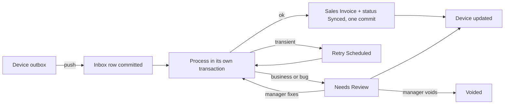

# 04. سجل الفواتير الفاشلة ومعالجتها في الخادم

المطلوب: أي فاتورة تفشل تصل إلى سجلها في الخادم، وتُعالج أخطاؤها وتُصحح هناك. يعالج هذا الملف F-01 وF-13 وF-15.

## 1. الفكرة

**كل فاتورة تدخل الـ Inbox قبل أن تُعالج.** لا يوجد مسار خاص بالفاشلة، بل كل فاتورة تُحفظ بحمولتها الأصلية في معاملة مستقلة، ثم تبدأ المعالجة. إذا فشلت فهي موجودة أصلًا في السجل، مع الخطأ والحمولة.

هذا يصلح السبب الجذري في F-01، لأن تسجيل الفشل لا يعود داخل المعاملة التي تُعاد للخلف.



## 2. تطوير `Offline Invoice Sync`

القرار: **توسيع DocType الموجود** بدل إنشاء سجل موازٍ. القيد الفريد والتقرير والبيانات التاريخية موجودة فيه، وسأبقي الاسم لتجنب ترحيل غير ضروري، بينما يكون العنوان الظاهر "سجل مزامنة الفواتير".

### الحقول الجديدة

| الحقل | النوع | الغرض |
|---|---|---|
| `status` | Select | القيم الموضحة في القسم 3 |
| `entity` | Select | invoice، customer، payment، shift_close |
| `device_id` | Data | من أين جاءت، ويصبح Link إلى POS Device في المرحلة 3 |
| `cashier` | Link إلى User | من باع فعلًا |
| `uploaded_by` | Link إلى User | من رفعها، وقد يكون زميلًا على الجهاز نفسه |
| `shift` | Link إلى POS Opening Shift | الوردية |
| `local_number` | Data، مفهرس | الرقم المطبوع، وللبحث عند الشكوى |
| `client_created_at` | Datetime | وقت البيع في الجهاز |
| `received_at`، `processed_at` | Datetime | قياس التأخير |
| `seq` | Int | ترتيب الجهاز |
| `client_version`، `protocol_version` | Data، Int | توافق الحمولة |
| `payload_hash` | Data | كشف التعارض |
| `original_payload` | Long Text، للقراءة فقط | الحمولة كما وصلت، ولا تتغير أبدًا |
| `payload` | Long Text | النسخة القابلة للتصحيح |
| `client_grand_total`، `client_paid_amount` | Currency | المقارنة مع الخادم |
| `server_grand_total` | Currency | بعد الحساب |
| `error_class`، `error_code` | Select، Data | التصنيف الثابت |
| `error_message` | Small Text | رسالة مفهومة |
| `traceback` | Code | للمطورين |
| `error_fingerprint` | Data، مفهرس | تجميع الأخطاء المتشابهة |
| `attempts`، `next_retry_at` | Int، Datetime | إعادة المحاولة |
| `depends_on` | Data | المرجع المنتظر |
| `resolution`، `resolution_note` | Select، Small Text | ماذا فُعل ولماذا |
| `resolved_by`، `resolved_at` | Link، Datetime | التدقيق |
| `attempt_log` | Table | سجل كل محاولة |

الجدول الفرعي `Offline Invoice Sync Attempt` يحفظ: الوقت، ومن نفذ، والفئة، والرسالة، والمدة. ويُفعّل `track_changes` لتوثيق أي تعديل.

### حقل في الفاتورة

يضاف Custom Field باسم `offline_id` إلى Sales Invoice وPOS Invoice بفهرس فريد، ويضاف `local_number` مع الرقم المحلي في المرحلة 2. هذا خط الدفاع الأخير: حتى لو فُقد سجل الـ Inbox يرفض القيد في قاعدة البيانات أي تكرار.

تأكد ذلك على `acc`: الفواتير القديمة بقيمة NULL، فلا تتعارض مع القيد الفريد.

## 3. الحالات

| الحالة | المعنى | التالي |
|---|---|---|
| `Received` | حُفظت ولم تبدأ | `Processing` |
| `Processing` | قيد التنفيذ | `Synced` أو غيرها |
| `Retry Scheduled` | خطأ مؤقت، بموعد في `next_retry_at` | `Processing` |
| `Blocked` | تنتظر مرجعًا في `depends_on` | `Received` |
| `Needs Review` | تنتظر قرار المدير | `Received` أو `Voided` أو `Resolved` |
| `Synced` | أُنشئت الفاتورة | نهائية |
| `Resolved` | حُلت يدويًا وربطت بفاتورة قائمة | نهائية |
| `Voided` | ألغيت مع سبب | نهائية |

ترحيل البيانات: `Pending` القديمة تتحول إلى `Needs Review` بملاحظة أنها بلا حمولة، و`Synced` تبقى، و`Failed` تتحول إلى `Needs Review`.

## 4. حدود المعاملات

هذا أهم جزء في التنفيذ.

```python
# pos_next/services/sync_inbox.py (sketch)

def ingest(envelope, device):
    """Transaction 1: nothing here may depend on invoice validity."""
    name = upsert_inbox(envelope, device)   # unique offline_id, conflict check by hash
    frappe.db.commit()  # nosemgrep: durability boundary
    return name

def process(name):
    row = lock_row(name)
    if row.status in FINAL_STATES:
        return row

    # Crash safety: the invoice may exist while the status update was lost
    existing = find_invoice_by_offline_id(row.offline_id)
    if existing:
        return mark_synced(row, existing)

    mark_processing(row)
    frappe.db.commit()  # nosemgrep

    try:
        frappe.set_user(row.cashier)
        invoice = invoice_processor.create_and_submit(row.payload, context_from(row))
        mark_synced(row, invoice)
        frappe.db.commit()  # nosemgrep: invoice and status commit together
    except Exception as exc:
        frappe.db.rollback()
        record_failure(name, classify(exc), exc)
        frappe.db.commit()  # nosemgrep: failure survives, unlike the current finally block
    finally:
        frappe.set_user(previous_user)  # captured before set_user(row.cashier)
```

القواعد:

- **منطق واحد:** `invoice_processor` يُستخرج من `update_invoice` و`submit_invoice`، وهما يبقيان غلافًا للتوافق مع الأجهزة القديمة.
- **لا ابتلاع للأخطاء:** شطب الرصيد والمحفظة والكوبون داخل معاملة الفاتورة. أي فشل يعيد الفاتورة كلها، فتظهر في السجل بدل نجاح ناقص (F-13).
- **المعالجة الخلفية:** `frappe.enqueue` بقائمة `short` و`job_id` لكل سجل، مع عامل يأخذ الأقدم أولًا لكل POS Profile.
- **مهمة كنس كل دقيقة:** `pos_next.tasks.sync.sweep_inbox` تعيد سجلات `Processing` الأقدم من 10 دقائق، وتنفذ `Retry Scheduled` المستحقة، وتفك `Blocked`.
- **الإعادة التلقائية:** `transient_server` حتى 5 مرات بفواصل متزايدة. `stock` كل 15 دقيقة حتى 4 مرات، لأن استلام بضاعة قد يحل المشكلة، ثم مراجعة.

## 5. شاشة المعالجة

في Desk قائمة باسم "مركز مزامنة الفواتير" مبنية على DocType مع Page مخصصة:

- **فلاتر سريعة:** تحتاج مراجعة، الأقدم، حسب الفرع، الجهاز، الكاشير، الفئة.
- **تجميع حسب الخطأ:** باستخدام `error_fingerprint`. عشرون فاتورة بسبب صنف معطل تُعرض كمشكلة واحدة.
- **بطاقة الفاتورة:** الحمولة كجدول مقروء، ومقارنة إجماليات العميل والخادم، والخطأ بلغة مفهومة، وسجل المحاولات.

### أدوات التصحيح

| الخطأ الشائع | أداة التصحيح |
|---|---|
| مخزون غير كاف | اختيار مستودع آخر، أو إعادة المحاولة بعد الاستلام، أو رابط لإنشاء Stock Entry |
| فترة محاسبية مقفلة | تغيير `posting_date` إلى تاريخ مسموح مع سبب |
| صنف معطل أو محذوف | استبدال الصنف، أو تفعيله ثم إعادة المعالجة |
| عميل غير موجود | ربطه بعميل قائم |
| طريقة دفع بلا حساب | إصلاح الإعداد ثم إعادة المعالجة، أو تحويلها لطريقة أخرى |
| فرق الإجمالي | اعتماد مبلغ العميل بخصم تسوية، أو تسجيل مبلغ مستحق بسبب |
| Batch أو Serial غير صالح | اختيار بديل صالح |
| وردية مقفلة | الربط بوردية مفتوحة كتسوية |
| فاتورة أنشئت يدويًا | ربطها وتحويل الحالة إلى `Resolved` |

### الإجراءات

| الإجراء | الصلاحية | ملاحظة |
|---|---|---|
| إعادة المعالجة | Nexus POS Manager | يعيدها إلى `Received` بعد التصحيح |
| إعادة جماعية | Nexus POS Manager | لكل فواتير البصمة نفسها، بعد إصلاح السبب |
| ربط بفاتورة قائمة | Nexus POS Manager | `Resolved` مع ملاحظة إلزامية |
| إلغاء | Nexus POS Manager | `Voided` مع سبب إلزامي، ويظهر للتدقيق |
| تعديل المبالغ | Accounts Manager | يتطلب سببًا، ويُسجل الفرق |

القيود:

- `original_payload` لا يتغير أبدًا، وكل تصحيح يظهر كفرق عنه.
- التعديل مسموح فقط في `Needs Review`.
- الكاشير لا يملك صلاحية الكتابة. الصلاحيات الحالية تعطي `POSNext Cashier` و`Sales User` إنشاء وكتابة، ويجب تقليصها لأن السجل سيحتوي بيانات مالية.
- الواجهة البرمجية للجهاز تكتب عبر `ignore_permissions` داخل دالة موثقة بالجهاز فقط.

## 6. التنبيهات والمراقبة

| الحدث | من يُبلّغ | القناة |
|---|---|---|
| فاتورة جديدة تحتاج مراجعة | مدير الفرع | إشعار Frappe |
| مراجعة أقدم من 4 ساعات | مدير الفرع والمحاسبة | بريد |
| فئة `bug` أو `contract` | الدعم الفني | Error Log وبريد |
| جهاز لم يتصل منذ 24 ساعة ولديه فواتير | مدير الفرع | إشعار |
| ارتفاع مفاجئ لنفس البصمة | الدعم الفني | بريد |

يُحدّث [التقرير الصحي](../../pos_next/pos_next/report/offline_sync_and_system_health_report/offline_sync_and_system_health_report.py) ليقرأ `error_message` مباشرة بدل بحثه الحالي في Error Log، ويضيف:

- عدد الفواتير حسب الحالة والجهاز.
- متوسط تأخير المزامنة والنسبة المئوية 95.
- معدل النجاح من أول محاولة.
- الفواتير المفتوحة حسب العمر.

## 7. الرجوع إلى الجهاز

بعد أي تغيير في الخادم:

1. `publish_realtime("pos_sync_status", ..., after_commit=True)` لغرفة الجهاز.
2. الجهاز يحدث صف outbox، واسم الفاتورة، وسجل الفواتير.
3. يُزال الحجز من المخزون المحلي عند `synced` أو `voided`.
4. إذا غاب الإشعار، يصل التحديث عبر `get_status`.

## 8. الاحتفاظ بالبيانات

| البيان | المدة المقترحة |
|---|---|
| سجلات `Synced`، الحمولة | 90 يومًا ثم تُفرغ الحمولة ويبقى الملخص |
| سجلات `Voided` و`Resolved` | حسب سياسة التدقيق |
| `Needs Review` | لا تُحذف تلقائيًا |

يجب مراجعة مدد الاحتفاظ مع متطلبات الضريبة والمحاسبة قبل التفعيل.

## 9. إقفال الوردية

- **أونلاين:** المسودة تحسب من الخادم، والإقفال يُمنع إذا كان في الجهاز فواتير `pending`، أو في الخادم فواتير غير نهائية لهذه الوردية.
- **قائمة مطابقة:** يرسل الجهاز `offline_ids` لكل فواتير الوردية كتبعيات، فأي فاتورة لم تصل توقف الإقفال، وتُذكر باسمها في المراجعة بعد 30 دقيقة.
- **أوفلاين:** عند تفعيل الميزة، يُسجل الإقفال ككيان outbox يعتمد على كل فواتير الوردية، ولا يُعتمد في الخادم قبل وصولها.
- **مراجعة معلقة:** تُمنع الموافقة النهائية على الإقفال حتى تنتهي مراجعة فواتير الوردية، أو يوافق المدير صراحة عبر `accept_unfinished`.
- **أثر جانبي مقصود:** الوردية قيد الإقفال لا تُعرض مفتوحة، ولا تُفتح وردية جديدة على الملف قبل اكتمال إقفالها.
